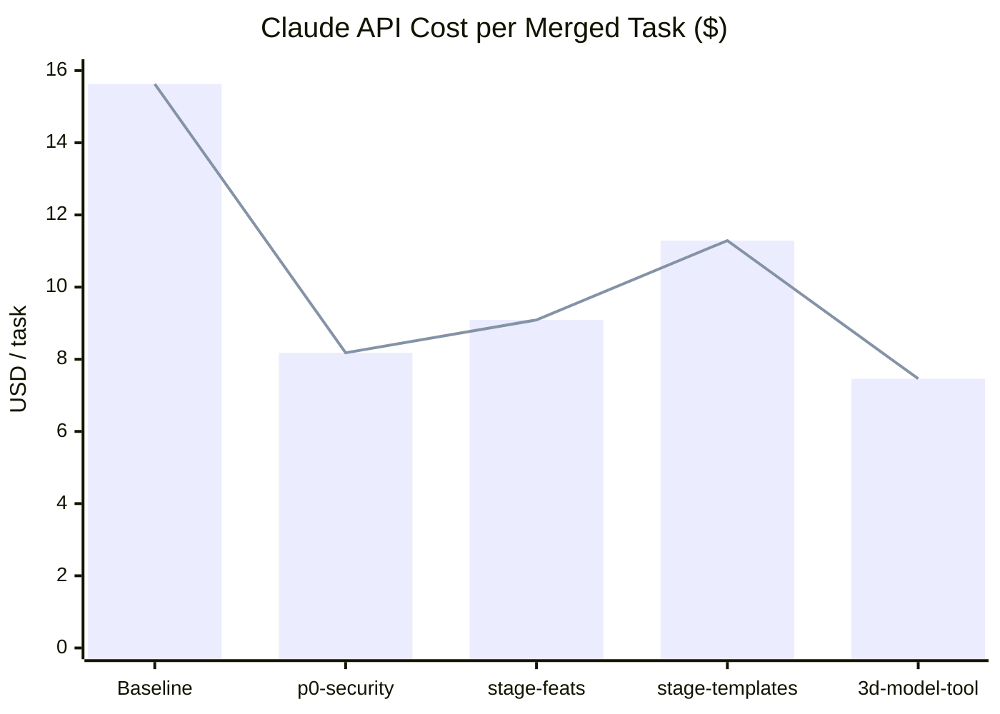
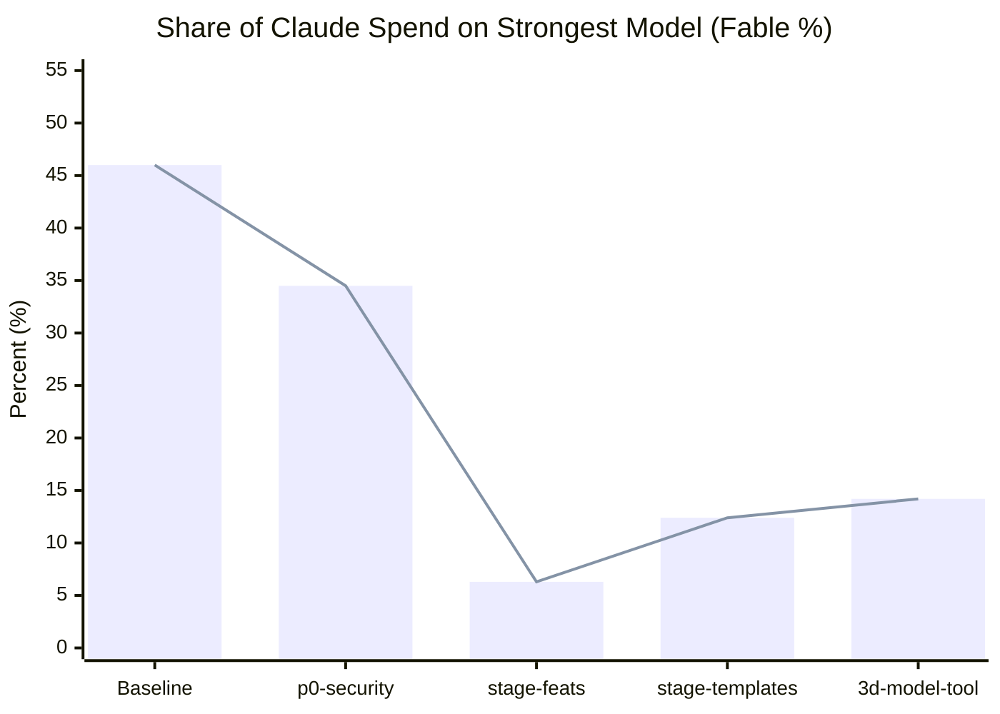
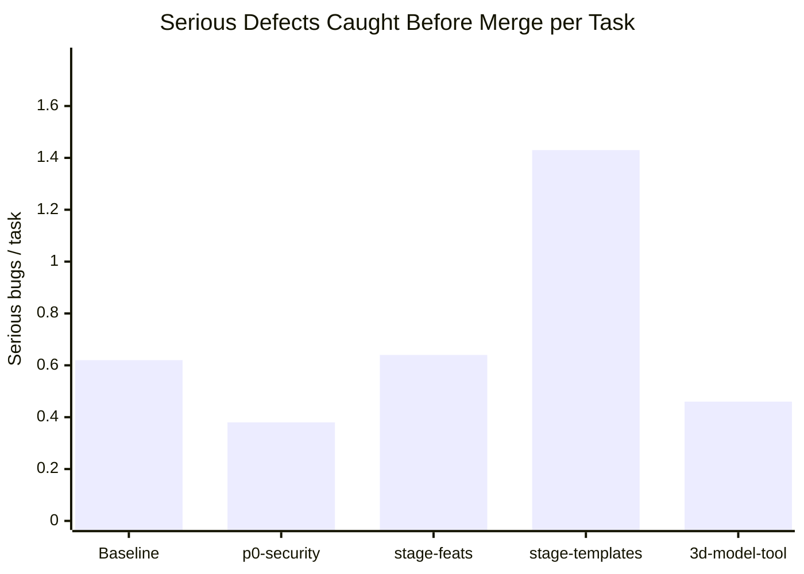
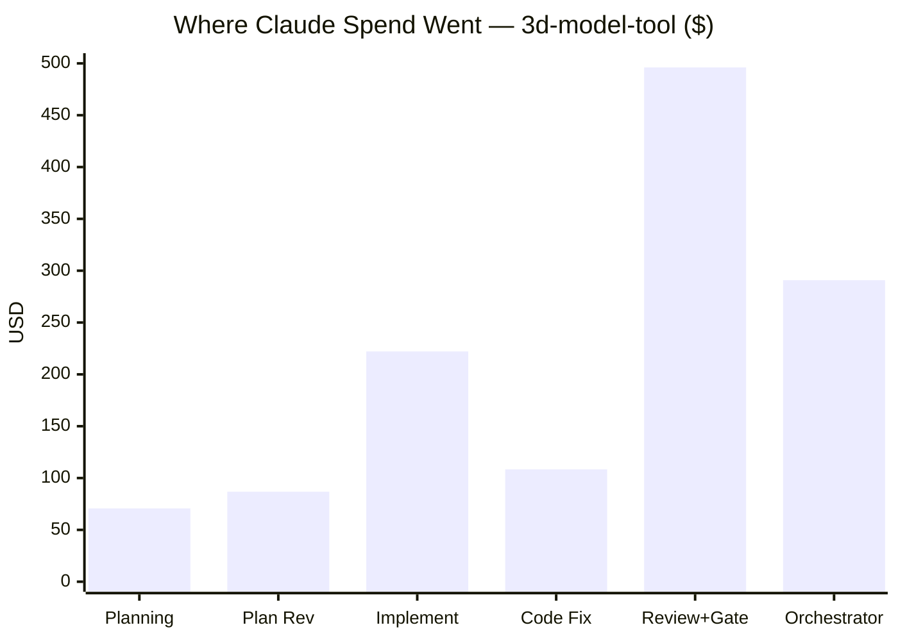

# ArchFlow Workflow Metrics

Automated measurements of whether `/archflow-run` is meeting its goal from [PURPOSE.md](PURPOSE.md): **the best automated code for the least compute**.

> All dollar figures are Claude-side API list prices (Sonnet 5.5 $2/$10, Opus 5.5 $4/$20, Fable 5.2 $8/$40, Haiku 5.5 $0.10/$0.50 per 1M input/output tokens, with 5-minute and 1-hour cache-write rates) computed from deduplicated Claude Code session and sub-agent transcripts. Cross-model counter-reviewer (Codex / Gemini) spend is tracked separately by call count because Codex CLI does not emit token usage in `result.json` yet.

## Is it working? (Latest measured run: `3d-model-tool`)

| Check | Result | Target | Status |
|---|---|---|---|
| Cost per merged task | **$7.46/task** | ≤ $10/task (baseline $15.60) | PASS |
| Strongest-model (Fable) share | **14.2%** | ≤ 20% (baseline 46%) | PASS |
| Review-to-write cost ratio | **1.5x** | ≤ 1.2x (Claude review vs write+fix) | WATCH |
| Review signal rate (acted on) | **94.4%** | ≥ 85% | PASS |
| No-decision review rows | **36.7%** | ≤ 40% (baseline 72%) | PASS |
| PROGRESS.md live-state hygiene | **66.7 KB** | ≤ 20 KB (archive finished milestones) | ACTION |
| Fix-verify Opus share | **94% (174/185)** | ≤ 65% (route minor test-backed verifies to Sonnet) | ACTION |

## Baseline & Run History

| Run | Dates | Tasks | Net LOC | Claude Cost | $/Task | $/1k LOC | Fable % | Review/Write | Serious Caught (/task) | Gate Escapes | Signal % | No-Decision Rows |
|---|---|---:|---:|---:|---:|---:|---:|---:|---:|---:|---:|---:|
| Pre-routing baseline *(baseline)* | 2026-11-17..2026-11-18 | 52 | — | $813.00 | **$15.63** | — | 46% | 0.56x | 32 (0.62) | 4 | 94.8% | 72.2% |
| p0-security | 2026-11-24..2026-11-24 | 16 | 10,270 | $130.88 | **$8.18** | $12.74 | 34.5% | 1.11x | 6 (0.38) | 0 | 90% | 54.4% |
| stage-missing-features | 2026-11-19..2026-11-24 | 107 | 99,995 | $972.27 | **$9.09** | $9.72 | 6.3% | 0.94x | 68 (0.64) | 0 | 97.8% | 39.6% |
| stage-templates | 2026-11-20..2026-11-24 | 100 | 52,057 | $1,129.27 | **$11.29** | $21.69 | 12.4% | 0.87x | 143 (1.43) | 13 | 96.4% | 31.2% |
| 3d-model-tool | 2026-11-19..2026-11-24 | 171 | 94,340 | $1,274.88 | **$7.46** | $13.51 | 14.2% | 1.5x | 78 (0.46) | 11 | 94.4% | 36.7% |

## Trends Over Time

### Cost per merged task (USD, API list price)



### Strongest-model (Fable) share of spend (%)



### Serious defects (critical + major) caught before merge per task



## Spend & Token Breakdown (`3d-model-tool`)



| Phase | Cost (USD) | Share | Total Tokens (incl. cache) | What it covers |
|---|---:|---:|---:|---|
| **Planning (initial + detail)** | $70.69 | 5.5% | 106M | Haiku explorers, research, Fable first plan, milestone detailing |
| **Plan revisions** | $86.80 | 6.8% | 116.3M | STOP pivots, counter-review plan revisions, plan vets |
| **Implementation (first pass)** | $222.11 | 17.4% | 694.5M | Fresh worktree implementers (153 Sonnet, 18 Opus hatch) |
| **Code revisions (fix rounds)** | $108.35 | 8.5% | 304.6M | Fresh fixers resolving task review & delta findings |
| **Reviews, fix-verify & gates** | $496.10 | 38.9% | 811.7M | Opus/Fable task reviews, fix verifies, merges, gate lenses, deferrals |
| **Orchestrator** | $290.83 | 22.8% | 808.9M | 35 Opus sessions (avg peak 280k ctx) |
| **Total** | **$1,274.88** | **100%** | **2842M** | 171 tasks · 94,340 net LOC (40,553 src + 53,787 tests) |

## With ArchFlow vs. Estimated Without Workflow (`3d-model-tool`)

This is an explicit, transparent guesstimate — not an exact controlled A/B test:

| Scenario | Estimated Claude Cost | Notes |
|---|---:|---|
| **Unreviewed direct Opus coding (floor)** | ~$468.00 | Scales first-pass implementation to Opus rates + 25% ad-hoc steering; assumes **zero** independent review and ships with defects unscreened. |
| **Direct coding + ad-hoc QA/bug-fix tax** | ~$702.00–$936.00 | Assumes 30–50% of the 78 serious defects caught before merge would otherwise surface later at ~$10–$12 of Opus debug turns each, **not counting human QA/debugging hours**. |
| **Actual ArchFlow run** | **$1,274.88** | **2.72×** the unreviewed coding floor; caught **78 serious defects** (14 critical, 64 major) and **756 minors** before merge (~$10.34 of verification overhead per serious defect prevented). |

## Who Catches the Bugs? (`3d-model-tool`)

| Catch Origin | Critical | Major | Minor | Takeaway |
|---|---:|---:|---:|---|
| In-model review only (`self`) | 10 | 29 | 221 | Opus/Fable reviewers probing real builds & invariants |
| Both families (`self+counter/tests`) | 4 | 16 | 79 | High-confidence corroborated defects |
| Cross-model only (`counter` / `tests`) | 0 | 16 | 402 | Caught exclusively by opposite-family review (25% of majors, 53.2% of minors) |
| Structure pass (`structure`) | 0 | 3 | 46 | Codebase organization findings (0.37/task) |

Cross-model counter-review reliability: **216/216** succeeded (100%), raising issues on **204/216** packets (including **47/49** post-fix delta reviews).

## Milestone Progression (`3d-model-tool`)

| Milestone | Tasks | Critical | Major | Minor | Structure (/task) |
|---|---:|---:|---:|---:|---:|
| M1 | 31 | 0 | 8 | 116 | 6 (0.19) |
| M2 | 63 | 11 | 36 | 302 | 25 (0.4) |
| M3 | 53 | 2 | 15 | 249 | 23 (0.43) |
| M4 | 24 | 1 | 5 | 89 | 9 (0.38) |

## Reproducing & Updating This Report

Measure any `/archflow-run` directory (and optionally append it to `metrics/history.json` and regenerate this file):

```bash
# Inspect a run without writing files
npm run metrics -- --run /path/to/repo/.archflow/runs/<name>

# Record the run into metrics/history.json and refresh METRICS.md
npm run metrics -- --run /path/to/repo/.archflow/runs/<name> --record --render

# Measure only sessions/reviews after a workflow change and compare before vs. after
npm run metrics -- --run /path/to/repo/.archflow/runs/<name> --since YYYY-MM-DD --id <slug> --note "<change>" --record --render
npm run metrics -- --compare baseline-2026-11-18 3d-model-tool
```
