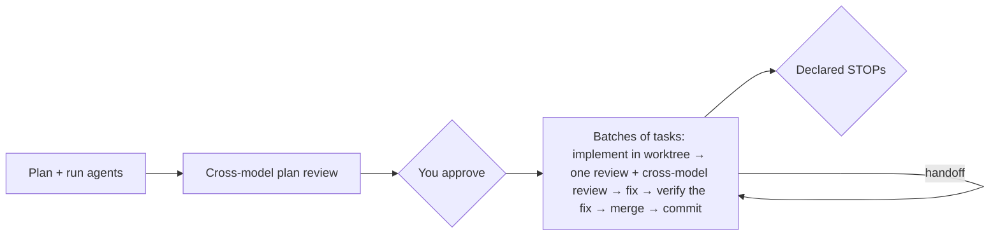

# ArchFlow

A lightweight, human-centered development workflow for Claude Code, Codex, and Google Antigravity. ArchFlow gives an AI coding agent an independent second opinion from a different model family, checked against rules your repository owns, and uses it to run large jobs without a human approving every step.

## What It Does

ArchFlow has three parts:

- **`archflow-local review`**: the counter-review. The agent that wrote a plan or finished a change sends it here; reviewers of another model family read it against the repository and its constitution and report what they found. The agent triages the reports; a human is brought in when a constitution rule's trigger or one of the `approval_rules` in `.archflow/config.yaml` matches (by default: SQL/database changes and material changes to an approved plan), and the caller must honor every returned human-review reason.
- **`archflow-local init`**: scaffolds what the review reads: `.archflow/config.yaml` (reviewer routing) and `.archflow/constitution/` (repository policy rules).
- **`/archflow-run`**: the workflow. You plan a large job once and approve it; the orchestrating session then hands each task to a sub-agent in its own worktree, reviews every task (in-model review plus the cross-model counter-review), and keeps its state in markdown and git.

Four skills put these in front of you:

| Skill | What it does |
|-------|--------------|
| `/archflow-init` | Runs `archflow-local init` and explains the result |
| `/archflow-constitution` | Explains and configures the repository's constitution rules |
| `/archflow-explore` | Maps a codebase into a maintained `docs/` set |
| `/archflow-run <name> [ask]` | Plans a large job, then orchestrates it across fresh sessions |

## Install

```bash
git clone <this-repo>
cd ArchflowV2
./install.sh
```

This verifies the tracked offline payload, installs the bundle under
`${ARCHFLOW_HOME:-$HOME/.archflow}/bundle/`, creates the `archflow-local` launcher under
`${ARCHFLOW_BIN:-$HOME/.local/bin}/`, and installs the four skills:

- Claude Code skills in `~/.claude/skills/`
- Codex skills in `~/.agents/skills/`
- Antigravity skills in `~/.gemini/config/skills/`

The launcher directory must already be on `PATH`; otherwise the installer prints the exact
`export PATH=...` line and stops. Install just one client's skills with
`./install.sh --claude`, `./install.sh --codex`, or `./install.sh --antigravity`. Restart Codex after installing if the skills
are not listed yet. Reviewer CLIs (Claude, Codex, Antigravity) must be installed and authenticated for the clients your routes use.

In Codex, invoke skills with `$` instead of `/`: `$archflow-init`, `$archflow-constitution`, `$archflow-explore`. `/archflow-run` is installed for every client but currently needs Claude Code as its orchestrator.

## Usage

### 1. Initialize

From the repository you want ArchFlow to review:

```
/archflow-init
```

This runs `archflow-local init`, which scaffolds `.archflow/config.yaml`, `.archflow/constitution/` (shipped rules in `default/`, yours in `custom/`), and `.archflow/.gitignore`. It writes nothing outside the repository and never edits the project root `.gitignore`. If a scaffold file differs from the shipped template, init refuses and names the file; keep your version, or re-run `archflow-local init --force` to replace every diverged scaffold file (this also resets `config.yaml`, while `constitution/custom/` is always preserved). Review reads the working tree, so the next review uses whatever is there; commit the files to share the policy.

### 2. Configure constitution rules (optional)

```
/archflow-constitution
```

Explains the constitution, inspects the current numbered rule files, and helps add, revise, or deprecate repository policy. Every active rule gets automated compliance review; a rule's optional `review_trigger` additionally requires a human decision when its condition matches. A requested policy change includes its scoped commit; explanation and inspection are read-only.

### 3. Explore (optional)

```
/archflow-explore
/archflow-explore authentication    # focus on a specific area
```

Produces or refreshes the maintained documentation set in `docs/`, each page stamped with its date, commit and covered paths so a refresh re-explores only what changed.

### 4. Review directly

Any agent can ask for a counter-review without the workflow:

```bash
archflow-local review --producer claude --input review.json
```

The payload carries the ask, the stage (`plan` before work starts, `implementation` for the finished change) and the paths the work touches; the result lists each reviewer's report. See [docs/cli/COMMANDS.md](docs/cli/COMMANDS.md) for the payload, result, and error codes.

### 5. Orchestrated runs

Use `/archflow-run <name> <ask>` in Claude Code for a large job you want to approve once and then let run:



- **The orchestrator never writes the code itself.** It hands each task to a sub-agent in its own worktree. The orchestrator runs the opposite-family counter-review (`archflow-local review`) on that worktree while a fresh reviewer checks the work against the task's acceptance criteria in parallel; when both finish, another fresh reviewer merges the counter-review's findings into the same table. A fresh fixer handles the findings worth fixing now, then the work is squash-merged and committed.
- **Each change is reviewed once; after that only the fix is checked.** A fresh reviewer always finds something, so sending a whole task back for review after every fix loops without converging. Instead a fresh reviewer verifies the fix alone. A fix that cannot be checked against anything independent, such as new math or a reworked approach, also gets a cross-model review of just the fix. The test and constitution reviewers run once per task. Tasks whose mistakes are cheap and visible, such as documentation, are marked `light` in the plan you approve and skip the per-task cross-model review; a whole-milestone counter-review covers them. No sub-agent waits on a review or is resumed later: an idle agent's prompt cache is gone after about five minutes. For the same reason sub-agents run only targeted tests on the files they touched; the orchestrator runs the full suite once per batch.
- **Everything is tracked in markdown.** Progress, decisions and reviews live in `.archflow/runs/<name>/`. Every few tasks the orchestrator writes a handoff, and you restart it in a fresh session with the same command.
- **You are involved only when it matters.** That means plan approval, the STOPs you declare, and halts for decisions that are yours: a change to what you get, reversing a decision you made, a risky change the plan does not cover, a kind of change your repository's rules ask a human to see, an unresolved critical finding, or an irreversible action. The orchestrator decides everything else, such as keeping a bug fix a sub-agent made along the way, and reports each of those decisions with how to undo it.

It needs the `archflow-local` launcher and authenticated reviewer CLIs. The run directory and its generated agents (`.claude/agents/`) are working files: delete them before opening a PR.

## File Structure

```
.archflow/
  .gitignore                        # Contains only: /runtime/
  config.yaml                       # Reviewer routing
  constitution/                     # Repository-owned policy rules
    default/                        # Shipped rules, refreshed only by init --force
    custom/                         # Preserved additions and ID-based replacements
  runs/
    my-run/                         # One directory per orchestrated run
      PLAN.md                       # Requirements, architecture, invariants, task table, STOPs
      PROGRESS.md                   # Status line, task log, session handoffs
      DECISIONS.md                  # Decisions and waivers
      reviews/                      # Per-task findings
```

## Key Design Decisions

- **Human-in-the-loop**: The agent does the labor, including verification; you approve the plan and every declared STOP, and are asked about anything irreversible.
- **Independent review**: The session that wrote the work does not review it. By default reviewers come from the opposite model family, and every task in a run gets a cross-model counter-review before it merges.
- **Repository-owned policy**: The constitution lives in your repository and is judged on every review; human decisions come from the rules' triggers and the configuration's `approval_rules` — the shipped defaults ask a human about SQL/database changes and material changes to an approved plan — and you can add, replace or retire them.
- **Plain markdown state**: A run's progress lives in files and git, so a lost session is resumed by running the skill again with the same name.

## Detailed Documentation

See [docs/OVERVIEW.md](docs/OVERVIEW.md) for the maintained documentation set: the whole-system map, the CLI, the review flow, child-reviewer dispatch, and the skills.

## Cleaning up older installs and repositories

Earlier versions of ArchFlow shipped an MCP server (`archflow-mcp`) and a gated task workflow with more skills. They are gone; what remains is above. Nothing breaks if you leave the old pieces in place, and most are cleaned up for you.

**An old install.** Re-running `./install.sh` removes what it provably wrote earlier:

- the `archflow-mcp` launcher in `${ARCHFLOW_BIN:-$HOME/.local/bin}/`, when it is exactly the two-line launcher an earlier install wrote;
- the retired skills `archflow-phase`, `archflow-prd`, `archflow-design`, `archflow-phase-design`, `archflow-phase-impl`, `archflow-status`, `archflow-upgrade` and `archflow-simple`, from each skill directory it installs into, only when the directory's `SKILL.md` names that skill;
- the `archflow` entry in `~/.gemini/config/mcp_config.json`, only when its command is `archflow-mcp` and the Antigravity skills are being installed (the default).

Anything that does not match is kept and reported. If you registered an `archflow` MCP server in a host's own settings, remove that entry by hand.

**An old repository.** Run `archflow-local init` (or `/archflow-init`) once. It removes the `archflow` server that older inits registered in `.mcp.json` (when its command is `archflow-mcp`) and the marked ArchFlow block in `.codex/config.toml`, then scaffolds. Since the shipped templates have changed, it will usually then refuse at a diverged scaffold file: your existing `.archflow/config.yaml` keeps working for review as it is (keys it no longer uses are ignored), so keeping it is safe; `archflow-local init --force` refreshes the config and the shipped default rules, preserving `constitution/custom/`. Leftover `.archflow/tasks/`, `workflow.yaml` and `hazards.yaml` are no longer read by anything; delete them by hand when you no longer need the history. Older inits also added the line `.archflow/** -text merge=binary` to the repository's root `.gitattributes`. Nothing needs it now, and it makes git refuse to merge `/archflow-run` notes line by line, so remove that line by hand; init leaves `.gitattributes` alone.
