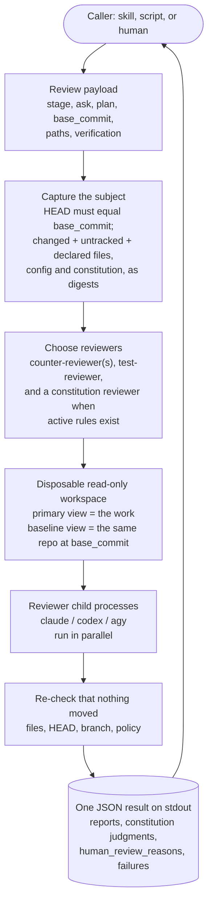

# OVERVIEW

**Explored:** 2026-11-11 · **Commit:** `f1fe689` · **Covers:** `src/local/`, `src/review/`, `src/dispatch/`, `src/init/`, `src/contracts/`, `src/repository/`, `assets/`, `skills/`, `install.sh`, `scripts/`

ArchFlow gives an AI coding agent a second opinion from a different model, and a repository-owned set of rules that opinion is checked against. The agent writes a plan or finishes some work; ArchFlow hands that plan or those changed files to reviewers from another model family, and returns what they found. Nothing more. The agent (and the human it works for) still decides what to do with the findings.

This page is the map. It describes the system as built, for humans auditing it. Caps-named pages under `docs/` are the maintained set, refreshed by `/archflow-explore`; `docs/validation/` is separate point-in-time evidence that is not kept current.

> **A review reports on the bytes it inspected. It never authorizes, approves, or advances anything.** There is no stored workflow state to trust or corrupt: each review reads the repository, asks the reviewers, and prints one JSON document.

## The three surfaces

| Surface | What it is | What it is trusted with |
|---|---|---|
| **Skills** (`skills/archflow-*`) | Prose playbooks the agent follows: `archflow-init`, `archflow-constitution`, `archflow-explore`, `archflow-run`. | Nothing. They are instructions, not enforcement. |
| **`archflow-local` CLI** (`src/local/`) | One bundled program with two commands: `review` and `init`. | Reading the repository and its config, running reviewer processes, printing a result. `init` writes only the scaffold files and removes old registrations it can prove it wrote. |
| **Reviewer CLIs** (`claude`, `codex`, `agy`) | The external model command lines the CLI launches as child processes. | Producing review text. Every output is parsed against a strict schema before it counts. |

Two senses of "CLI" are worth keeping apart: `archflow-local` is ArchFlow's own program; `src/dispatch/cli.ts` is the code that *launches* the other tools.

Details of the commands are in [cli/COMMANDS.md](cli/COMMANDS.md); the skills are in [workflow/SKILLS.md](workflow/SKILLS.md).

## `archflow-local review`

A caller (a skill, a script, a human) builds a small JSON payload: the `stage`, the `ask`, the `plan`, the `base_commit` (HEAD must still equal it), the `paths` the work touches, and for an implementation review the `verification` it ran. It passes `--producer claude|codex|antigravity` to say which client is asking, and the payload either through `--input <file>` or on stdin.

There are two stages:

- **`plan`**: the reviewers judge a proposed plan against the ask and the current code.
- **`implementation`**: the reviewers judge the changed files against the baseline commit, plus the verification evidence.

### What the reviewers see

The subject is every file git reports as changed against HEAD, every untracked file, and every path the payload declares, read from the working tree (so uncommitted work is reviewed, and a worktree reviews itself). A path that traverses a symlinked parent, or names a directory or other non-file entry, is refused; a path that is itself a symlink is reviewed as a symlink (its link text), never followed. The snapshot is capped at 25 MiB. Reviewers get a disposable temporary directory holding two read-only checkouts made with `git archive`: `primary` (the base commit with the changed files applied on top) and `baseline` (the base commit alone). The real repository path is never given to the child.

The prompt each reviewer receives is built from `assets/review-inputs.yaml` and a rubric file in `assets/rubrics/`. Readable prompts for each role are checked in under `test/fixtures/review-prompts/`.

### Who reviews

| Role | Runs | Judges |
|---|---|---|
| `counter-reviewer` | always (one per configured route) | the general rubric criteria |
| `test-reviewer` | always | only the test-owned criteria (the plan's test strategy; an implementation's verification evidence and test quality) |
| `adjudicator` (the *constitution reviewer*) | only when active constitution rules exist | each rule: compliance, and whether its `review_trigger` matched |

Each role's routes come from `.archflow/config.yaml`, most specific first: `producers.<producer>`, then `overrides.phase-design` (plan) or `overrides.phase-impl` (implementation), then `roles`, with a built-in `gpt-6.1-sol`/low fallback for the test reviewer. A payload may also carry a per-call `review_routes` entry, which replaces the configured routes for that role. A route can name a cc-switch `provider`, which launches the claude CLI through cc-switch so non-Claude models can run behind it.

"The other model family" is a property of the shipped template (a Claude producer is reviewed by GPT, a Codex producer by Claude), not a check. Nothing stops a repository from configuring a same-family reviewer; see [LIMITATIONS.md](LIMITATIONS.md).

### What comes back

The result lists each reviewer's report (an explicit `issues_found` or `no_issues_found` plus feedback text), the constitution judgments, any `failures` (a reviewer that could not complete), and `human_review_reasons`. A human-review reason appears when a configured `approval_rules` entry matches (a subject rule for the whole stage, or a content rule whose path globs match a path the payload declares, see [LIMITATIONS.md](LIMITATIONS.md)) or when the constitution reviewer says a rule's `review_trigger` matched. Reasons are advice to the caller: the caller must ask the human; the CLI cannot.

If any required reviewer fails, `ok` is `false` with `REVIEW_INCOMPLETE`, and the reports that did arrive are still returned. The process exits non-zero and prints `review failed: <CODE>` on stderr. Before returning, the review re-reads the files, HEAD, branch and policy; if any moved during the review the whole result is replaced by `SUBJECT_CHANGED`, because the reports would no longer describe the current work.

## `archflow-local init`

Input-free (it never reads stdin; `--force` is its only flag). From the repository root it:

1. removes the exact MCP registrations older versions wrote (an `archflow` server in `.mcp.json` whose command is `archflow-mcp`, and the marked block in `.codex/config.toml`), leaving anything it cannot prove it owns;
2. scaffolds `.archflow/config.yaml`, `.archflow/constitution/` (`default/` shipped rules, `custom/` repository rules) and `.archflow/.gitignore`;
3. runs diagnostics (Node version, `claude` and `codex` versions and login, managed-policy files, ancestor git-ignore rules hiding the scaffold).

If a scaffold file already differs from the shipped one, init refuses with `scaffold-diverged`; `--force` overwrites shipped files but preserves `custom/`. Review does not need init: with no `.archflow/config.yaml` or constitution it uses the shipped template and rules from the installed bundle.

## Installation and shape on disk

`install.sh` copies one bundle, `dist/archflow-local.mjs`, with an `assets/` directory beside it, writes an `archflow-local` launcher, and copies the skills for Claude Code, Codex and Antigravity. The CLI finds its assets as siblings of the bundle; from a source checkout it finds `assets/` two levels up. The build (`scripts/`, `npm run release:*`) is described in [DEPENDENCIES.md](DEPENDENCIES.md).

In a repository, ArchFlow owns only `.archflow/config.yaml`, `.archflow/constitution/`, `.archflow/.gitignore` (which ignores `/runtime/`) and, for the orchestrated workflow, `.archflow/runs/<name>/`. There is no database and no workflow state file.

## The orchestrated workflow

`archflow-run` is the one workflow skill. A human approves a single plan; a fresh Claude Code session then works through it in batches with per-task sub-agents in git worktrees. Each task gets an in-model review and the cross-family review, called through `skills/archflow-run/scripts/counter-review.sh`, which builds the payload from a directory's changed files and runs `archflow-local review`. State is markdown under `.archflow/runs/<name>/` plus one commit per task. Its stops and halt rules live in the skill, not in the CLI. See [workflow/SKILLS.md](workflow/SKILLS.md).

## Page map

- [cli/COMMANDS.md](cli/COMMANDS.md): the two commands, flags, input and output.
- [review/COUNTER-REVIEW.md](review/COUNTER-REVIEW.md): prompts, rubrics, routing, constitution review, result shape.
- [mcp/DISPATCH.md](mcp/DISPATCH.md): reviewer child processes, adapters, workspace, failure handling.
- [workflow/SKILLS.md](workflow/SKILLS.md): the four skills.
- [COMPLEXITY.md](COMPLEXITY.md): per-subsystem simplification audit.
- [PATTERNS.md](PATTERNS.md): code idioms and conventions, with file references.
- [DEPENDENCIES.md](DEPENDENCIES.md): runtime and toolchain surface, external CLIs, release.
- [TESTING.md](TESTING.md): vitest projects, npm scripts, where tests go.
- [LIMITATIONS.md](LIMITATIONS.md): what the system does not guarantee.

## Glossary

- **Producer**: the client session asking for a review (`claude`, `codex`, `antigravity`). It is chosen with `--producer`, needs no routing config of its own, and selects which reviewers run.
- **Stage**: `plan` or `implementation`. Internally they run on the recipes named `phase-design` and `phase-impl`; those names survive in config keys for compatibility.
- **Subject digest**: a SHA-256 over the stage, ask, plan, base commit, declared paths, verification and the content of every file reviewed. It identifies exactly what was inspected.
- **Policy digest**: a SHA-256 over the config and constitution. An implementation review can carry the plan review's digest as `expected_policy_digest`; a mismatch stops the review with `POLICY_CHANGED`.
- **Constitution**: versioned rules in `.archflow/constitution/` (`default/` shipped, `custom/` the repository's own). Every active rule receives an automated compliance judgment; a rule with a `review_trigger` can also name a reason for human review.
- **Approval rule**: a `config.yaml` entry (`subjects` or content path globs) that adds a human-review reason to the result.
- **Dispatch envelope**: the sealed, digested package handed to the child-launching code (`src/review/envelopes.ts`).
- **Workspace**: the disposable temporary directory a reviewer child runs in; deleted when the review ends.
