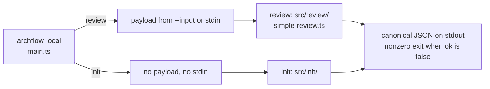

# cli/COMMANDS

**Explored:** 2026-11-11 · **Commit:** `f1fe689` · **Covers:** `src/local/`, `src/init/`, `src/contracts/simple-review.ts`, `src/contracts/dispatch-failure.ts`, `src/review/simple-review.ts`, `src/review/simple-context.ts`, `assets/config.template.yaml`, `skills/archflow-run/scripts/counter-review.sh`

`archflow-local` is the only program ArchFlow ships. It has two commands: `review`, which asks other AI models to review a plan or a change, and `init`, which prepares a repository for `review`. Everything else ArchFlow does is a skill (see [SKILLS](../workflow/SKILLS.md)) that calls one of these two commands.

This page is also the contract for callers of `review`: the payload to send, the result to expect, and how to treat it. How the review itself works is in [COUNTER-REVIEW](../review/COUNTER-REVIEW.md); how reviewer processes are launched is in [DISPATCH](../mcp/DISPATCH.md).

## Invocation shape

```
archflow-local review --producer <claude|codex|antigravity> [--input <json-file>]
archflow-local init [--force]
archflow-local --help
```

- **One bundle.** The command is `dist/archflow-local.mjs`, a single file with the shipped `assets/` directory beside it. The installer puts both under `~/.archflow/bundle/` and a launcher named `archflow-local` on the `PATH`. The bundle reads its defaults (config template, constitution rules, rubrics, review recipes) from that sibling `assets/`.
- **Payload commands** (`review`) read JSON from `--input <file>`, or from stdin when `--input` is omitted. If stdin is a terminal and no file was given, the command fails at once instead of waiting.
- **Input-free commands** (`init`) never read stdin and reject `--input`. A parent process commonly keeps stdin open, so a command that waited for end-of-file would hang even though it already had everything it needed. The command table in `src/local/commands.ts` marks which commands take a payload, and both the argument check and `--help` are generated from it, so help cannot drift from behavior.
- **Output** is one canonical JSON document on stdout. **A failure exits nonzero**: a result with `"ok": false` exits 1 and writes the error code to stderr. A bad argument or an unreadable payload does too, as one `{"ok": false, "error": …}` document with code `CONTRACT_INVALID` and issue `local-command-invalid` that names the problem.
- `--force` belongs to `init` only and `--producer` to `review` only; the other command rejects them.



## review: one counter-review of the current work

`review` asks reviewers from a different model family than the asking client to read a plan or a change, and returns their reports. It runs in the caller's working directory, so a Git worktree reviews its own files; that is how an orchestrating session gets cross-model review of a sub-agent's worktree. It keeps no state between calls: nothing is written into the repository except a diagnostics log under `.archflow/runtime/` when a reviewer fails unexpectedly, nothing resumes, and a second call is a fresh review.

`--producer` names the client session that is asking. It is required because the configured reviewer routes depend on it (the shipped template sends a Claude session to GPT reviewers and a Codex session to Claude reviewers, for example).

### The payload

| Field | Required | Meaning |
| --- | --- | --- |
| `schema_version` | yes | The string `"1"`. |
| `stage` | yes | `"plan"` reviews a proposed approach before work starts; `"implementation"` reviews the finished change. |
| `ask` | yes | What the person actually asked for, in their terms. Reviewers judge the work against it. |
| `plan` | yes | The plan, or for an implementation review the plan that was followed. Nonblank text. |
| `base_commit` | yes | The full 40-character `HEAD` commit recorded before the work began. `HEAD` must still equal it when the review runs. |
| `paths` | yes | Repository-relative files the work adds, changes or deletes, including planned additions and deletions. Unique entries, files only (no directories), nothing under `.git` or `.archflow/tasks` (a path there is rejected as `INPUT_INVALID`). This declares the scope of the review; files that are changed but not listed still appear as context. Approval rules (see `human_review_reasons`) see only the declared `paths`, so declare every output that needs those checks. |
| `verification` | for `implementation` | What was run and what it showed, including checks that were unavailable or not applicable. Optional for a plan, where reviewers assess the proposed verification strategy instead. |
| `review_routes` | no | Per-call reviewer routes: any of `counter-reviewer`, `test-reviewer` and `adjudicator`, each `{model, effort, provider?}`. A route given here beats configuration for that role on this call only. |
| `roles` | no | Which reviewers to dispatch: a non-empty, unique subset of `counter-reviewer`, `test-reviewer` and `adjudicator`. Omit it for the first review of a change, which runs every applicable role. Name a subset for a follow-up pass or a retry, so a concern that already ran is not repeated. |
| `expected_policy_digest` | no | The `policy_digest` returned by an earlier review. If the repository's config or constitution has changed since, the review stops with `POLICY_CHANGED` before spending any reviewer time. |

Unknown fields are rejected. A rejected payload fails with `INPUT_INVALID` and a message that names every offending field, because callers build this payload by hand.

What gets reviewed is the working tree as it is: every file that differs from `HEAD`, every untracked file that is not ignored, and every declared path, up to 25 MiB. The reviewers also get the same repository at `base_commit` as a baseline to compare against. A symlink is reviewed as a link (its target text), but a path that passes through a symlinked directory is refused.

### The result

```json
{
  "schema_version": "1",
  "ok": true,
  "value": {
    "stage": "implementation",
    "subject_digest": "…", "policy_digest": "…", "config_digest": "…", "constitution_digest": "…",
    "reports": [ … ],
    "constitution": { "status": "complete", "judgments": [ … ] },
    "human_review_reasons": [ … ],
    "failures": [ … ]
  }
}
```

- **`reports`** has one entry per reviewer that finished. Counter-reviewer and test-reviewer entries carry `role`, `reviewer_id`, the `route` that ran (adapter, family, model, effort, optional provider), an `outcome` that is exactly `issues_found` or `no_issues_found`, and `feedback`, the reviewer's concise text. A constitution entry carries `report`, a plain summary of its judgments. Claude reviewers also carry `usage` (tokens, turns, duration, estimated cost) when the CLI reported it; a missing number means unknown, not zero.
- **`constitution`** is `not-applicable` when the repository has no active rules, `complete` when the constitution reviewer judged every active rule, `not-requested` when the call's `roles` left the constitution reviewer out, and `failed` when it could not. Each judgment names `rule_id` and `rule_version` and gives `compliance` (`pass`, `fail` or `uncertain`), a `rationale`, whether the rule's human-review `trigger` was `not-matched`, `matched` or `uncertain`, and the `trigger_evidence`.
- **`human_review_reasons`** is a list of plain sentences, each a reason a human should look before the work is accepted. It is empty when none applies. Two things add to it: a project `approval_rules` match in `.archflow/config.yaml` (a whole stage, or declared `paths` matching a glob such as `**/*.sql`; a changed file that is not declared never triggers a content rule, and `skills/archflow-run/scripts/counter-review.sh` declares every changed and untracked file), and a constitution rule whose `review_trigger` came back `matched` or `uncertain`.
- **`failures`** lists reviewers that did not produce a usable report: `role`, `reviewer_id`, `route`, a `code` and a safe `message`.
- The four digests identify the bytes the review covered (`subject_digest`) and the policy it ran under (`config_digest` for `.archflow/config.yaml`, `constitution_digest` for the rules, `policy_digest` for both together). They are for detecting drift, not for a human to read.

`ok` is `true` only when every required reviewer reported and, if there are active rules, the constitution reviewer completed. Otherwise `ok` is `false` and `error` is set. A failed result can still carry `value` with the reports that did arrive, so a caller can read them, but they are not complete coverage.

### Error codes

| Code | When |
| --- | --- |
| `INPUT_INVALID` | The payload failed validation, a path passes through a symlinked directory, or a path names something that is not a file or symlink (a directory, for example). |
| `BASELINE_CHANGED` | `HEAD` no longer equals `base_commit`. |
| `POLICY_CHANGED` | `expected_policy_digest` does not match the current config and constitution. |
| `INPUT_TOO_LARGE` | The changed files exceed 25 MiB. |
| `CONFIG_INVALID` | `.archflow/config.yaml`, the constitution, a configured route, or the shipped rubric is invalid, or a role has no route. |
| `CONFIG_MODEL_UNSUPPORTED` | A configured or per-call route names a model whose family ArchFlow cannot tell. |
| `SUBJECT_CHANGED` | The files, the branch, or the policy changed while reviewers were running, so the reports do not describe the current work. |
| `REVIEW_INCOMPLETE` | One or more reviewers failed (see `failures`); the available reports do not give complete coverage. |
| `CANCELLED` | The process received an interrupt. Reviewer processes are stopped and their scratch files removed. |
| `REVIEW_FAILED` | Anything unexpected while preparing or validating the review. The result carries only a generic message. |
| `CLI_MISSING`, `AUTH_UNAVAILABLE`, `CLI_VERSION_UNSUPPORTED`, `RATE_LIMITED`, `TIMEOUT`, `UNSUPPORTED_MODEL`, `CONFIG_MODEL_UNSUPPORTED`, `PROCESS_FAILED`, `MODEL_OUTPUT_INVALID`, `REPOSITORY_VIEW_UNAVAILABLE` | A reviewer could not be run or returned unusable output. These usually appear as the `code` of an entry in `failures`, with a fixed safe message (see [DISPATCH](../mcp/DISPATCH.md#how-failures-are-classified)), and the call itself reports `REVIEW_INCOMPLETE`. A route rejected before any reviewer starts (`CONFIG_INVALID`, `CONFIG_MODEL_UNSUPPORTED`) is instead the call's own error code. |

A `failures` entry whose process failed in a way ArchFlow could not classify has the code `DISPATCH_FAILED`; its cause is recorded in `.archflow/runtime/diagnostics/internal-errors.log` and on stderr, not in the result.

### How to treat the result

A successful result means the review coverage was completed. It does not mean the work is accepted, correct, or approved by a human; reviewers give independent opinions and can be wrong in either direction.

- **Read every report.** Fix the findings you agree are real and say why you set the others aside. Run the checks that bear on what you changed.
- **Honor `human_review_reasons`.** Take each one to the person in plain language before treating the work as accepted. A review that found nothing wrong can still require a human.
- **Do not loop on reviewers.** The call does not re-review your fixes; ask for another review only when the change was significant, and tell the person when fixes were not independently re-reviewed.
- **When `ok` is `false`,** read any partial reports, repair what `failures` names (a missing CLI, a login that expired, a rate limit), and call again. There is no job to resume and no cache of the reviewers that did finish; a repeat call runs all of them again unless it names only the failed ones in `roles`. Transient failures (rate limits, timeouts, dropped connections) are already retried twice inside the call.
- **Carry `policy_digest` forward.** Pass the plan review's value as `expected_policy_digest` on the implementation review, so a change to the config or the constitution in between is noticed.

`skills/archflow-run/scripts/counter-review.sh` is the shipped caller. Given a directory, an output directory holding `ask.txt` and `plan.txt` (and `verification.txt` for an implementation), a producer, a stage and optionally a comma-separated list of roles, it records `HEAD`, lists the changed and untracked files as `paths`, builds the payload, runs `archflow-local review`, and writes `result.json` (everything) and `summary.json` (what a person reads: outcomes, feedback, failures, human-review reasons) next to it. It prints one line and exits with the review's exit code.

### Reviewer routing and configuration

`review` reads `.archflow/config.yaml` from the working tree on every call, so an edit applies to the next review. If the file does not exist it falls back to the shipped template instead of failing. The constitution works the same way. A file that exists but is invalid is an error, never a silent fallback.

Routes name a model, an effort and optionally a cc-switch `provider`. For each role the first match wins: the call's `review_routes`, then `producers.<producer>`, then `overrides.phase-design` (plan reviews) or `overrides.phase-impl` (implementation reviews), then the top-level `roles`. The test reviewer additionally has a built-in last resort of `gpt-6.1-sol` at `low`. A `counter-reviewers` list runs several counter-reviewers at once. The shipped template routes each producer to the other family. Older configs may carry keys this version ignores (`implementation`, `repositories`, `max_attempts`, `roles.producer`, `roles.effort-reviewer`, and overrides for `explore`, `prd` and `design`, and approval subjects `prd` and `design`); they parse without error and have no effect.

## init: prepare a repository

`init` creates the files `review` reads, and nothing else. It never creates a commit and never edits the project's own `.gitignore`.

It writes, relative to the repository root:

- `.archflow/config.yaml`, copied from the template: reviewer routing and `approval_rules`.
- `.archflow/constitution/`: shipped rules under `default/`, an explanatory `README.md`, and `custom/` (holding only a README) for the repository's own rules.
- `.archflow/.gitignore`, which ignores `/runtime/`, the scratch directory reviews may write diagnostics into.

Rules for existing files:

- **Nothing diverged is overwritten.** If a scaffold file exists with different bytes, `init` refuses with `scaffold-diverged`, names the file on stderr, and writes nothing. Keep the repository's version and stop, or re-run with `--force`.
- **`--force`** replaces diverged scaffold files, including `config.yaml`, with the shipped bytes. It always preserves `custom/`.
- **Older flat constitutions** (rules directly in `.archflow/constitution/`) are migrated only under `--force`: files with shipped names are replaced by the current defaults, and any other numbered rule moves into `custom/`. The whole resulting rule set is validated first, and a conflict stops everything before any write. Plain `init` refuses a flat layout instead of guessing.
- Installing a newer bundle never changes a repository's policy by itself; refreshing defaults is an explicit `init --force`.

Before scaffolding, `init` removes the MCP registrations that earlier versions wrote, so a repository that used them does not keep pointing at a server that no longer exists. This is ownership-guarded: it touches only the `archflow` entry in `.mcp.json` whose command is exactly the old `archflow-mcp` launcher, and the marker-delimited block in `.codex/config.toml` that earlier inits appended. It deletes a file only when the ArchFlow entry was all that was in it. Anything it cannot prove is ArchFlow's (a different command, unparseable JSON, markers that do not pair up, a symlinked file or directory) is left alone and reported. It runs first so that a refused scaffold does not also leave the stale registrations behind.

The result reports `assets` (what was `created`, `unchanged`, `overwritten`, `preserved_custom`, and any constitution migration), the `legacy_registrations` removed or left alone, and `diagnostics`: the Node version, a preflight of the Claude and Codex CLIs (version, whether logged in, whether a managed policy file is present), and any generated ArchFlow file hidden by an ancestor Git ignore rule. The diagnostics exist so a person finds out at setup, not at the first review, that a reviewer CLI is missing or logged out. `init` is safe to repeat; re-running it is the recovery path after an interrupted run.

## Where the pieces are built and shipped

`npm run release:stage` builds the bundle and its assets into a staging directory, `release:check` verifies it, and `release:write` writes the tracked `dist/` payload that the installer copies. `check:release` runs the check, a smoke run of the built bundle, the integrity mutation tests and a reproducibility build together. Installing is a separate, explicit step (`install.sh`) and is never part of the build.
