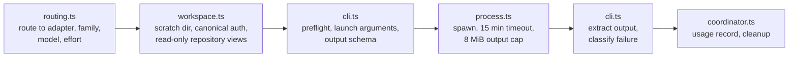

# mcp/DISPATCH

**Explored:** 2026-11-11 · **Commit:** `f1fe689` · **Covers:** `src/dispatch/`, `src/contracts/dispatch-failure.ts`, `src/contracts/dispatch-usage.ts`, `src/review/inputs.ts`, `src/review/envelopes.ts`, `src/review/response-schema.ts`, `docs/validation/review-file-reference-probes.md`

This page keeps its historical path under `docs/mcp/`; nothing in ArchFlow is an MCP server any more.

Dispatch is how a review reaches a model. A review decides who should review what ([COUNTER-REVIEW](../review/COUNTER-REVIEW.md)); dispatch launches the right first-party command-line client (`claude`, `codex` or `agy`) as a child process, hands it a read-only copy of the repository and a prompt, and turns whatever comes back into either validated output or a classified failure. It deliberately knows nothing about plans, rules or approval: it takes a sealed input and a route and returns bytes, so the review code stays in charge of meaning.

## The flow

- **`routing.ts`** is pure policy. It picks the raw route candidates for a role (the order is on the [counter-review page](../review/COUNTER-REVIEW.md#routing)) and validates each into `{adapter, family, model, effort, provider?}`. The model name decides the family (`claude-` is Claude, `gpt-` is Codex, `gemini-` is Gemini through Antigravity), the family decides the adapter, and an effort the adapter does not support is rejected here, before any process exists. A cc-switch `provider` forces the Claude adapter and is refused on a Codex or Gemini model rather than silently rerouted.
- **`workspace.ts`** creates the disposable scratch directory and the read-only repository views.
- **`cli.ts`** holds the three adapters and everything coupled to a specific CLI: minimum versions (Claude 2.1.205, Codex 0.122.0, Antigravity 1.0.0), the login check, launch arguments, schema projection, output extraction and failure classification.
- **`process.ts`** runs one child: no shell, its own process group, piped stdio, a fifteen-minute deadline, an 8 MiB cap on each output channel, and SIGTERM then SIGKILL after a short grace period on timeout, overflow or cancellation. It also refuses any single argument of 128 KiB or more.
- **`coordinator.ts`** assembles one attempt end to end: acquire the workspace, preflight, build the invocation, run the child, check for failure, extract the output, write the usage record, and dispose of the scratch space.
- **`cli.ts`** also contains `serializeDispatchAll`, a process-wide queue. All reviewers of one review are started together as a single link in it, and the next review waits for the whole link, so one `archflow-local` process has at most one review in flight. It does not coordinate separate processes or interactive CLI sessions.

## What each adapter launches

| Adapter | Command | What constrains the reviewer |
| --- | --- | --- |
| `claude-cli` | `claude -p --safe-mode --tools Read,Grep,Glob --add-dir <inputs> --disable-slash-commands --strict-mcp-config` with an empty MCP config, no session persistence, no setting sources, JSON output with the schema inline, `--model`, `--effort` | Read, search and glob tools only; nothing that edits or runs commands. With a `provider`, the same argument list is run as `cc-switch start claude <provider> -- …`. |
| `codex-cli` | `codex exec --ephemeral --ignore-user-config --ignore-rules --strict-config -s read-only` with the review root as working directory, schema and final-output files, project instructions off, skills off, most features disabled but the shell readers enabled | A read-only sandbox. Codex reads files through shell tools, so those are left on and the sandbox is the authority against writes. |
| `antigravity-cli` | `agy -p … --print-timeout 900s --output-format stream-json --json-schema <file> --disable-slash-commands --dangerously-skip-permissions` | Only its own host rules: it keeps its normal tools and context. It is not a filesystem sandbox. |

All three get the same prompt and the same working directory: a `review/` folder in the scratch space holding `review-inputs/<reviewer>/` (the generated Markdown inputs) and `repositories/<name>/` (the snapshots). The prompt names files by path relative to that folder. Schemas and output files for each child live in a separate `children/<attempt>/` directory outside the view, so two children of the same adapter never collide. No adapter receives the payload on stdin; stdin is closed with nothing in it. `--print-timeout` is set to the fifteen-minute process limit because `agy`'s own five-minute default can cut off a review that is still working.

Each host expects structured-output schemas in its own dialect, so the single review schema is projected per adapter, dropping metadata the host rejects. The full result is always validated by ArchFlow, not trusted to the host.

## Repository views

Reviewers see the repository as plain files, never the real checkout. For each view `git archive` extracts the repository at a commit into the scratch space (an archive has no `.git` link back to the repository's objects, so a reviewer cannot walk Git history or reach other branches). The `primary` view then has the captured working-tree files applied over it, using the exact bytes and modes that were fingerprinted; the `baseline` view stays at the base commit. The review's own `.archflow/constitution/` and any task storage from older versions are removed from `primary`, and the whole `.archflow/` is removed from `baseline`. Applying files rejects any path that escapes the view or passes through a symlink or a directory in the way.

All children of a review share one view: it is created lazily the first time a reviewer needs it, so they inspect byte-identical files without extracting twice. The review owns it and removes it only after every child has settled.

## How failures are classified

Failures are mapped to a short list of codes with fixed, safe messages. Exception text, unknown issue codes and model output are never copied into a reported failure.

| Code | Meaning |
| --- | --- |
| `CLI_MISSING` | The reviewer CLI is not installed or not on `PATH`. |
| `CLI_VERSION_UNSUPPORTED` | Installed, but older than the minimum version. |
| `AUTH_UNAVAILABLE` | Not logged in, or the login could not be refreshed. |
| `RATE_LIMITED` | HTTP 429, quota or usage limit, or a session limit. A session limit says to wait for the allowance to reset or choose another route. |
| `TIMEOUT` | The fifteen-minute process deadline, or Antigravity's own print timeout. |
| `UNSUPPORTED_MODEL` | The service says the selected model does not exist or is unsupported. |
| `CONFIG_INVALID`, `CONFIG_MODEL_UNSUPPORTED` | The route is wrong: unsupported effort, unsafe model name, unknown model family, a provider on a non-Claude model, `gpt-6-astra` at `max`. |
| `PROCESS_FAILED` | The process failed and nothing more specific applies. An exit class says how: an exit status, a signal, an argument too long, or `transient-transport` for dropped connections and 502/503/504. |
| `MODEL_OUTPUT_INVALID` | The CLI returned no structured output, output that is not plain JSON, no final result wrapper, or (from the review layer) output that breaks the reviewer's contract. |
| `REPOSITORY_VIEW_UNAVAILABLE` | The read-only snapshot could not be built. |

Some wrappers report failure while exiting with status zero (Claude's JSON error wrapper, Antigravity's `ERROR` status), so the classifier reads the explicit error marker rather than trusting the exit code, and does not treat ordinary stderr warnings or reviewer prose as failure. Antigravity's exact print-timeout diagnostic is recognized as a timeout even at exit zero, and its partial output is discarded even if it happens to be JSON.

Only a few failures count as transient and are retried (twice, after one and four seconds): rate limits, timeouts, an unavailable snapshot, and `PROCESS_FAILED` with the transport class. Authentication, missing CLIs, bad output and cancellation are never guessed to be temporary, and a retry never changes the route; choosing a different reviewer is a decision for the caller.

### A completed answer after a temporary service error

Antigravity can mark its final wrapper as an error because an earlier Gemini capacity error is still in the conversation, even though the model recovered and finished. The adapter accepts that one case only when the same stream shows a clean exit, one turn, the exact native 503 capacity-error text, a finished step after the error as the very last step, matching conversation identities and final structured output. Damaged streams, other errors, later steps, timeouts and cancellation cannot use this path. Recovery only lets the final structured bytes through to the normal validation; answers are never lifted from intermediate steps.

## Usage records

Each CLI dispatch, successful or failed, writes one small JSON file to `<ARCHFLOW_HOME>/usage/` (normally `~/.archflow/usage/`), next to the installed `bundle/` so that replacing the bundle on update keeps the history. Source checkouts write nothing, since they would be writing into a shared installation. Files are named `<completion-unix-ms>-<dispatch-uuid>.json`.

A record holds the repository, adapter, model, effort, provider, CLI version, the kind and digest of the input and its size, timing, whether the dispatch succeeded or failed, and for a failure the stage and code. Claude records also carry the numbers the CLI reported (input, output, cache and thinking tokens, turns, durations, estimated cost); for other adapters, missing measurements are unknown, not zero. The status describes the CLI run, not whether the review concluded anything. No prompts, source, feedback, stdout or stderr are copied in.

The directory is mode `0700` and records `0600`. Each completed dispatch deletes regular record files older than seven days (never other files, directories or symlinks), so cleanup happens on the next dispatch rather than on a timer. One file per dispatch avoids interleaved writes from concurrent reviews. A logging error never affects a review result.

## What is and is not guaranteed

Context hygiene is best-effort, not an enforced isolation boundary, and this page should not suggest otherwise.

- The reviewer is a first-party CLI running as the invoking user. Nothing at the filesystem level stops it reading outside its view, and Antigravity keeps its normal tools. What ArchFlow guarantees is narrower: the real repository path is never put in the child's environment or prompt, the repository bytes it is shown are the captured snapshot, and the CLI is launched with the least-capable flag set each CLI offers.
- **Authentication stays canonical.** Children receive the caller's real `HOME`, Codex also receives `CODEX_HOME` (default `~/.codex`), and Claude receives an existing `CLAUDE_CONFIG_DIR`. A disposable copy of the credentials would strand a refreshed OAuth token when the scratch space is deleted. The other forwarded environment is small: `USER`, `PATH`, locale, proxy variables and `NODE_EXTRA_CA_CERTS`. Suppressing user instructions is done by the CLI flags above, independently of where credentials live.
- **cc-switch:** a Claude route with a `provider` is launched through `cc-switch`, with `~/.local/bin` added to the child's `PATH` because that is where it usually lives. Two accepted limits: the setting-source suppression is expected to compose with cc-switch's own settings file but depends on the CLI version, and the preflight still probes the globally installed `claude`, so a Claude install reachable only through cc-switch fails as `CLI_MISSING`.
- **Reviews can legitimately take up to fifteen minutes.** The deadline bounds a hung child, not a working one.

## Fragility to watch

Two parts of this subsystem are coupled to the external CLIs and will drift: the launch argument lists, written out literally for each CLI release, and the failure classifier, which matches free-text error messages to find rate limits, login problems and model names. When a CLI updates, look here first.

A third part is coupled to the providers behind those CLIs: the output schemas. Every root is a plain object. A provider that tightens its structured-output validator shows up as an unclassified `PROCESS_FAILED`, and only the opt-in real-host test project can catch it, because the local schema compiler accepts far more than the providers do. Those tests spend paid model calls and are never part of a normal check.

The shipped template's reviewers are GPT-6.1 Sol (counter-review and test review) and Claude Opus 5.5 (constitution review, and counter-review for Codex sessions). Existing repository routes are not rewritten when the template changes.
