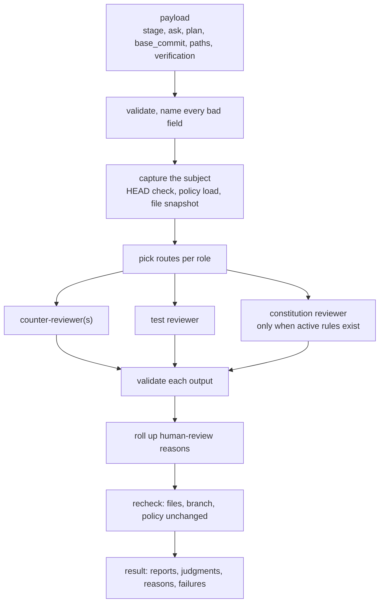

# review/COUNTER-REVIEW

**Explored:** 2026-11-11 · **Commit:** `f1fe689` · **Covers:** `src/review/`, `src/dispatch/routing.ts`, `src/contracts/simple-review.ts`, `src/contracts/review.ts`, `src/contracts/adjudication.ts`, `src/contracts/constitution.ts`, `src/contracts/config.ts`, `assets/review-inputs.yaml`, `assets/rubrics/`, `assets/constitution/`, `docs/validation/review-file-reference-probes.md`

Counter-review gives the working AI independent feedback from models it did not come from. The asking session sends a plan or a finished change to `archflow-local review`; reviewers of another model family read it against the repository and report back; the asking session decides what to do with the reports. The caller-facing payload and result are described in [COMMANDS](../cli/COMMANDS.md#review-one-counter-review-of-the-current-work); this page explains what happens in between and why.

The central idea is separation of roles. The session that wrote the work does not review it, and a model reviewing work from its own family tends to share the author's blind spots, so by default the reviewers come from the opposite family. The reviewers advise; the working AI triages their feedback; a human is brought in only by an explicit rule. A clean review certifies that review coverage completed, never that the work is right or approved.

## The flow

1. **Validate.** The payload is parsed strictly; a rejection names each offending field.
2. **Capture the subject once.** `HEAD` must equal `base_commit`. The repository's config and constitution are loaded and digested. Every changed, untracked and declared file is read into memory (25 MiB cap) and fingerprinted. All reviewers see this one capture.
3. **Pick routes** for the counter-reviewer, the test reviewer, and, when there are active constitution rules, the adjudicator (see below).
4. **Run every reviewer at the same time**, each in a fresh process against the same read-only snapshot. They are launched by [dispatch](../mcp/DISPATCH.md); one review is in flight per `archflow-local` process, and the children of that review run together. A transient failure is retried twice (after 1 and then 4 seconds); other failures are not.
5. **Validate each output** against the strict contract for that role. Unusable output is a failure of that reviewer, never a pass.
6. **Roll up** human-review reasons from the approval rules and the constitution.
7. **Recheck.** The files, the branch and the policy are captured again. If any of them moved while reviewers were running, the whole result is replaced by `SUBJECT_CHANGED`, because reports about bytes that no longer exist would mislead.

Every reviewer is allowed to finish, even when a sibling has failed, and the successful reports are kept in the result. There is no resumable job and no cache: after a failure, the next call starts over.

## The reviewers

| Role | Reads | Returns |
| --- | --- | --- |
| **Counter-reviewer** | The ask, the plan, declared paths, verification, the rubric criteria not owned by the test reviewer, and the repository views | `outcome` and `feedback` |
| **Test reviewer** | The same, but with only the test-owned criteria | `outcome` and `feedback` |
| **Constitution reviewer** (the adjudicator) | The subject and the active constitution rules, with no rubric | One judgment per rule |

Why a separate test reviewer: tests and verification are easy to skim past. Giving them to a dedicated reviewer with its own route means a general reviewer is never quietly widened to cover them, and an unavailable specialist route never changes what another reviewer is responsible for. A reviewer's responsibility is fixed by the stage's recipe, not by which routes happen to be available.

**Choosing roles.** A call may name the roles it wants in an optional `roles` field: any subset of `counter-reviewer`, `test-reviewer` and `adjudicator`. Omitted, every applicable role runs, which is what a first review of a change wants. A subset is for the pass after that. Once the test reviewer and the constitution reviewer have reported on a change, repeating them on every later pass costs a dispatch each and mostly re-judges bytes they have already judged; a caller that only needs a second opinion on a fix asks for the counter-reviewer alone, and a caller retrying one failed route asks for that role alone. Naming a subset never widens what a named reviewer covers. When the constitution reviewer is left out although active rules exist, the result's constitution status is `not-requested`, distinct from `not-applicable` (no active rules) and `failed`. A selection that matches no applicable role is rejected as `INPUT_INVALID` rather than returning an empty success.

**Rubrics.** A plan review uses `simple-plan-v1` (ask fidelity, correctness of the approach, interface reality, decision readiness, proportionality, test strategy, plus two non-blocking criteria about confidence and advisory remarks). An implementation review uses `implementation-v1` (correctness, design conformance, interface fidelity, verification evidence, test quality, anti-shortcut, simplicity, duplication, dead code, error handling, and three non-blocking criteria). `test-strategy` is the test reviewer's criterion for plans; `verification-evidence` and `test-quality` for implementations. Both test criteria weigh what a check costs alongside what it catches: a test that is slower than what it proves requires, or that repeats another test's protection, is reported with the cheaper equivalent, never as a request for a coverage target. The criteria live in `assets/rubrics/` and are read and strictly parsed on every review; a missing or invalid file fails the review with `CONFIG_INVALID`. Criterion order matters and is part of the rubric digest.

**Recipes.** What each reviewer is told, which input groups it gets (subject, rubric, verification, rules, repository) and the guidance attached to each file live in `assets/review-inputs.yaml`. They ship in the bundle and are not copied into repositories, so a repository cannot weaken a reviewer by editing its prompt.

**What a reviewer must return.** Counter and test reviewers return exactly `{"outcome": "issues_found" | "no_issues_found", "feedback": "…"}`, with nonblank feedback. A clean review is therefore explicit sign-off, never inferred from silence, arbitrary JSON, or an interrupted process. Feedback should say where the problem is, what fails and why it matters; reviewers are asked not to narrate their investigation, quote whole files, or list what is correct. The constitution reviewer returns one judgment per assigned rule (details below). Output with any other shape is rejected as `MODEL_OUTPUT_INVALID` for that reviewer.

## What reviewers see

Each reviewer gets a small set of generated Markdown files under `review-inputs/<reviewer-id>/` in its working directory (the ask, the plan, the declared paths, the verification evidence, its rubric criteria, the rules), each referenced in the prompt with a sentence on how to use it, plus the repository under `repositories/`:

- `repositories/primary/` holds the work as it is now: the captured files laid over the base commit.
- `repositories/baseline/` holds the same repository at `base_commit`, so a reviewer can compare.

Both are disposable snapshots extracted from Git (so they have no link back to the real repository) and leave out the repository's own `.archflow/constitution/` (the rules reach the constitution reviewer separately, as the exact set being judged against) and any leftover task storage from older versions. Declared paths set the scope; other changed files and unrelated edits are context, not findings.

The prompt (instructions, the generated JSON response example, and the file references) is capped at 16 KiB and is never truncated to fit; if it does not fit, the review fails loudly. Review material never rides on the command line except that prompt: the files are read from disk, Codex and Antigravity load the response schema from a file, and Claude's inline schema is size-checked, because one oversized command-line argument fails with an opaque `E2BIG`. The response example shown to the model comes from the same schema that validates its answer, so the example and the check cannot disagree.

CLIs differ in whether they expand a file reference immediately or need to be told to read it, and one drops the tail of a large file. [The probes](../validation/review-file-reference-probes.md) record what was observed, which is why the instructions tell reviewers to read any referenced file the CLI did not already load.

## Routing

For each role the first available source wins:

1. `review_routes` in the call (for one call only);
2. `producers.<producer>` in `.archflow/config.yaml`, keyed by the asking client;
3. `overrides.phase-design` for a plan review or `overrides.phase-impl` for an implementation review;
4. the top-level `roles`;
5. for the test reviewer only, the built-in `gpt-6.1-sol` at `low`.

A role with no route at all is `CONFIG_INVALID`. A `counter-reviewers` list produces several counter-reviewers, which run side by side as `counter-reviewer-1`, `counter-reviewer-2`, and so on; the shipped template does this for Antigravity sessions.

A route is `{model, effort, provider?}`. The model name decides the family and so the CLI: `claude-…` runs the Claude CLI, `gpt-…` the Codex CLI, `gemini-…` the Antigravity CLI. A `provider` (claude routes only) sends the Claude launch through `cc-switch`, which lets a non-Claude model such as `glm-5.3` run through the Claude CLI. An unknown model prefix, an effort the CLI does not support, a provider on a Codex or Gemini model, and `gpt-6-astra` at `max` are rejected before any process starts, with an error that says why; nothing is silently downgraded.

Routing is configuration, not code. Opposite-family review is the shipped default (Claude sessions get GPT reviewers, Codex sessions get Claude reviewers, Antigravity sessions get both), and a repository can change it. The producer is the asking client, not a role: it needs no route of its own.

## The constitution

The constitution is the repository's standing policy, kept as numbered Markdown rules in `.archflow/constitution/`: shipped rules in `default/`, the repository's own in `custom/`. Each rule has a stable `id`, a positive `version`, a `status` (`active` or `deprecated`), the rule text, and optionally a `review_trigger` and an `enforced_by` list. A custom rule with the same `id` as a default replaces it entirely; a deprecated override suppresses the default. A directory of rules with duplicate ids, bad frontmatter or empty text is `CONFIG_INVALID`. If `.archflow/constitution/` does not exist in the repository, the bundled defaults apply.

Every active rule is judged on every review. The constitution reviewer receives the rules under opaque slot names (`rule-1`, `rule-2`, …) and must return exactly one judgment for each slot: `compliance` (`pass`, `fail`, `uncertain`), a `rationale`, a `trigger` (`not-matched`, `matched`, `uncertain`) and `trigger_evidence`. The review maps slots back to rule ids and versions itself, so the model never authors identities. A missing slot, an extra one, an invalid value, or a trigger reported on a rule that has none makes the whole constitution review a `MODEL_OUTPUT_INVALID` failure. A review with no active rules has no constitution reviewer and reports `not-applicable`.

The `review_trigger` is what turns a rule into a human boundary. Compliance is agent work first: a failed judgment is something for the working AI to fix. A trigger that comes back `matched` or `uncertain` is different, because it says a human should decide, so it becomes a `human_review_reasons` entry that quotes the evidence, whatever else the review found.

## Approval rules and human-review reasons

Independently of the constitution, `.archflow/config.yaml` can say that some work always needs a human. `approval_rules.subjects` may list `phase-design` (every plan review) or `phase-impl` (every implementation review); `approval_rules.content` lists path globs, and any declared path (the payload's `paths`) matching one adds a reason that lists the matching paths. Changed files that are not declared are reviewed as context but never trigger an approval rule, so a caller must declare every output that needs these checks. The shipped default flags every declared `**/*.sql` path; `skills/archflow-run/scripts/counter-review.sh` declares every changed and untracked file. The subject names are older vocabulary kept for compatibility: a plan review is evaluated as `phase-design` and an implementation review as `phase-impl`; `prd` and `design` are accepted in config but never match.

Glob matching is pinned: the pattern must match the whole repository-relative path, case-sensitively; `*` and `?` stay inside one path segment; `**` as a whole segment matches zero or more segments, so `db/**` matches everything under `db/` and `**/*.sql` matches both `a.sql` and `db/a.sql`. Nothing here reads the filesystem.

The approval rules and the constitution triggers are two independent ways to reach the same output, a sentence in `human_review_reasons`. Approval rules cannot bypass constitution checks: the constitution is judged on every review that includes the constitution reviewer, whether or not an approval rule matched, and a matched approval rule does not stand in for a compliance judgment. Equally, a clean review cannot erase a reason; the reasons are reported even when every reviewer says `no_issues_found`. Approval rules are matched on every call whatever `roles` it names, so a narrowed pass never hides a path the repository asks a human to see. What the caller must do with them is in [COMMANDS](../cli/COMMANDS.md#how-to-treat-the-result).

Reviewers are told that the invoking session acts under authority its human delegated: it may make implementation-level decisions within the supplied ask and plan, such as keeping necessary work the plan did not list or fixing a defect found along the way. A note that the session decided something is therefore not, by itself, evidence that a human decision is missing; a trigger about a kind of change, such as database behavior, still matches on what the changed code does. How a reason is handled is the caller's business: `/archflow-run` triages each one against what the human delegated at plan approval, stops for a decision the human kept or a kind of change the repository's rules single out, and otherwise decides, records and reports it.

## Detecting drift

Three digests bind a result to what it covered. `subject_digest` covers the stage, ask, plan, base commit, declared paths, verification and a fingerprint of every captured file (path, mode and content hash). `config_digest` and `constitution_digest` cover the policy, and `policy_digest` combines them. Policy is read from the working tree, so there is no pinning: editing the config or a rule takes effect on the next review, and a caller that wants to notice such an edit between plan and implementation carries `policy_digest` forward as `expected_policy_digest`. Before returning, the review re-reads the files, the branch name and the policy; any difference is `SUBJECT_CHANGED`.

## What review does not do

- It does not accept, approve or commit anything, and it does not modify the repository; reviewers work in read-only snapshots, and the only thing written back is a stack trace on an unexpected internal error, under `.archflow/runtime/`.
- It does not re-review fixes. The scope text given to every reviewer says that no follow-up pass will certify later fixes, and callers should say so when they fix after a review. A caller that wants a second opinion on a fix asks for one deliberately and narrowly: `/archflow-run` does so only for a fix that cannot be checked against anything independent, with the counter-reviewer alone, on a scratch worktree whose `HEAD` is the pre-fix state, so the subject is the fix and not the whole task again ([SKILLS](../workflow/SKILLS.md#archflow-run)).
- It does not prove isolation. Reviewer processes run as the invoking user with real credentials; see [DISPATCH](../mcp/DISPATCH.md#what-is-and-is-not-guaranteed).
- It does not decide who is right. When reviewers disagree with each other or with the author, that is the working AI's judgment to make, and the human's when a reason says so.

## Usage records

Every reviewer process, successful or not, leaves one small usage record (adapter, model, effort, timing, status, and tokens and cost when the Claude CLI reports them) in the installation's usage directory; see [DISPATCH](../mcp/DISPATCH.md#usage-records). The same measurements come back on each Claude report as `usage`.
