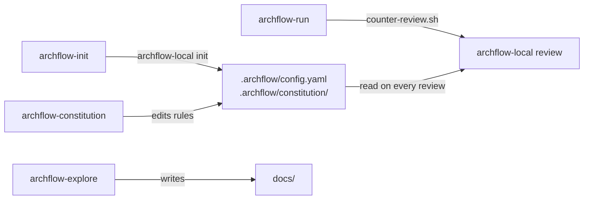
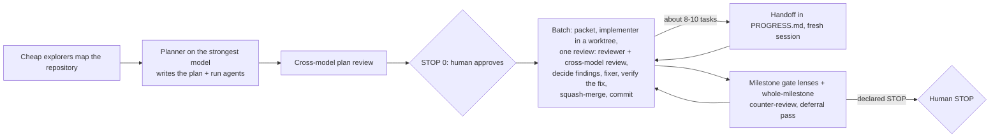
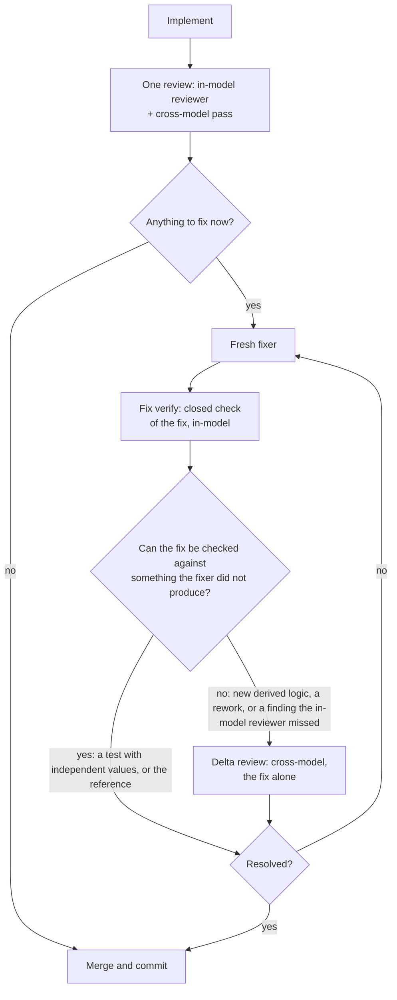

# workflow/SKILLS

**Explored:** 2026-11-11 · **Commit:** `f1fe689` · **Covers:** `skills/`, `src/init/`, `src/local/`, `assets/constitution/`, `skills/archflow-run/scripts/counter-review.sh`, `skills/archflow-run/scripts/cleanup.sh`, `skills/archflow-run/scripts/wait.sh`

ArchFlow ships four skills. Each is a short, portable instruction file (the Agent Skills format) in `skills/`, and the installer copies the same set into Claude Code, Codex and Antigravity. Skills do not carry workflow state or talk to a server: the only program behind them is `archflow-local` ([COMMANDS](../cli/COMMANDS.md)), and the only durable state is ordinary files in the repository and Git.

| Skill | Purpose |
| --- | --- |
| `archflow-init` | Scaffold the files `archflow-local review` reads and clean up registrations older versions left behind |
| `archflow-constitution` | Explain and edit the repository's constitution rules |
| `archflow-explore` | Produce or refresh the maintained `docs/` set |
| `archflow-run <name> [ask]` | Plan a large job once, then orchestrate it across fresh sessions with sub-agents, worktrees and cross-model review |

Claude Code and Antigravity invoke skills with `/` (`/archflow-init`); Codex uses `$` (`$archflow-init`). `archflow-run` is installed for every client but needs Claude Code as the orchestrator, because it generates `.claude/agents` and spawns worktree-isolated sub-agents; in another client it says so and stops.

## archflow-init

Runs `archflow-local init` from the repository root. It scaffolds `.archflow/config.yaml` (reviewer routing and approval rules), `.archflow/constitution/` (the repository's policy rules) and `.archflow/.gitignore`, removes the MCP registrations earlier versions of init wrote, and reports diagnostics: the Node version, whether the Claude and Codex CLIs are installed and logged in, and whether an ancestor Git ignore rule hides the generated files.

The skill explains the outcome in plain language. It refuses to overstate the isolation of reviewers (the diagnostics themselves say it is best-effort), never edits the project's own `.gitignore` (it asks the human to add exceptions instead), and treats a `scaffold-diverged` refusal as a question for the human: keep the repository's files, or re-run with `--force`. Invoking the skill authorizes scaffolding the shipped defaults, removing the legacy registrations init reports, and committing the resulting repository files; the skill performs that commit itself after the checks pass. When the human asks how reviewers are routed, it explains the `roles` and `producers` sections of the config and points at the commented example in the template.

## archflow-constitution

Explains and maintains the rules in `.archflow/constitution/`. The constitution is repository-owned policy for human trust boundaries and durable engineering constraints; it is not a style guide, a task checklist, or a way to compensate for a model's current weaknesses.

An explanation request edits nothing. A request to add or change a rule authorizes the scoped edit and its commit. The skill reads the existing rules first and works out the effective set after custom replacements; puts new rules and default replacements in `custom/` under an unused two-digit prefix; keeps each rule one independently reviewable policy with a stable kebab-case `id`; raises the `version` when contents change; and deprecates rather than deletes. It adds a `review_trigger` only when the repository genuinely wants a human decision whenever a condition appears, and the trigger must be something a reviewer can observe in the plan, the changed files or the repository, not a process fact such as who approved what. It names `enforced_by` only for mechanical checks that exist. It validates the whole rule set after editing and shows the diff and its practical effect on review. Refreshing shipped defaults is a separate, explicit `archflow-local init --force`; a rule edit never authorizes it.

It also says out loud, before changing them, that the rules about explicit human authority and a truthful plan, and the rule that guards the policy files, exist to keep a human in the loop. How rules are judged is on the [counter-review page](../review/COUNTER-REVIEW.md#the-constitution).

## archflow-explore

Produces or refreshes the maintained documentation set (this directory): caps-named pages, each with a stamp of date, commit and covered paths. In refresh mode it diffs each page's covered paths since its stamped commit and re-explores only the pages whose code changed, plus any focus area the user names. It may delegate large explorations to parallel sub-agents with complete briefs, reviews the pages against the code, checks links and stamps, and commits the documentation without another approval. It also makes sure the target repository's `CLAUDE.md` lists the pages and states the rule that a change altering behavior a page describes must update that page.

## archflow-run

The orchestrated workflow, for large jobs ("port this system", "build these fifty tasks") where approving each step would cost more than it is worth and one long session would run out of context. The run lives in `.archflow/runs/<name>/`: `PLAN.md` (requirements, architecture, invariants, commands, model routing, milestones, task table, declared STOPs), `PROGRESS.md` (a status line, task log, deferred findings, handoffs), `DECISIONS.md`, `BRIEF.md`, `reviews/`, and a gitignored `packets/`. Git is the record of what merged, and where the ledger and git disagree, git wins.

**Why markdown instead of a server.** A strong orchestrator follows a written protocol reliably, and resuming needs only an honest ledger and the commit history. The trust boundaries a human needs are plain rules in the skill:

- the plan is approved before any code, and with it the review depth of every task;
- the plan is written by a planner sub-agent on the strongest model, never by the orchestrating session;
- declared STOPs end the session until the human answers;
- the run halts between STOPs only for a decision that is the human's: a change to what they get, reversing a decision they made, a risky change the plan does not cover, a kind of change the repository's rules ask a human to see, an unresolved critical finding, or an irreversible or outward-facing action;
- every other decision is the orchestrator's, and none is hidden: each is recorded with how to undo it and reported in the next message that ends a turn;
- commits stay local;
- the human is assumed not to be watching. Every message that ends a turn stands on its own: it opens with where the run stands, and it restates each open question in full, with the choices and a recommendation, instead of pointing back at an earlier message. A halt between STOPs is also written into `PROGRESS.md` with the status `AWAITING USER (halt)`, so a fresh session can ask again in full. Results that are not a reason to stop, such as a milestone gate verdict, ride along in the next closing message.

Everything else in the skill and its `PROTOCOL.md` is a default whose numbers (batch size, fix rounds, task size) can be adapted and recorded in `DECISIONS.md`.

**Why review is the part that stays tooled.** ArchFlow's counter-review is what this workflow lacked when it was run by hand. Routing, snapshot views and structured reports are worth reusing rather than re-prompting. When an implementer returns, the orchestrator runs `archflow-local review` on its worktree through `scripts/counter-review.sh` ([COMMANDS](../cli/COMMANDS.md#how-to-treat-the-result) describes the script). That dispatches the opposite-family counter-reviewer, the test reviewer and the constitution reviewer. At the same moment the orchestrator spawns a fresh reviewer sub-agent, which does its own acceptance check without waiting for the counter-review. When both finish, another fresh reviewer, in merge mode, folds the counter-review into the same findings table: a point both reviewers made becomes one row naming both, since agreement between model families is strong evidence. A counter-review that cannot run blocks the merge; it is never replaced by self-review.

**Why a change is reviewed once.** The first version of this loop sent a task back through every reviewer after every fix, and it did not converge. A fresh reviewer has no memory of the previous round, so it does not confirm fixes: it reviews from scratch, and on any nontrivial diff it finds something. Each re-review also received the whole task diff rather than the fix, so it re-judged code already judged, and each fix added new code for the next round to object to. The loop ended at its round cap, not at a clean review, and it spent two opposite-family dispatches per round. So the open-ended question, "what is wrong with this?", is now asked once per change, by two model families at the same time. After a fix the question is closed: is each finding fixed, and did the fix break anything?

A fresh in-model reviewer does the fix verify. For each finding it says whether the fix resolves it and on what basis: a test whose expected values the fixer did not compute, a comparison with the run's reference, or reading alone. It can reopen only what it was asked to check, so fix rounds end.

**Why some fixes still get a cross-model look.** An in-model verifier is reliable on "does the code now do what the finding asked". It is unreliable on "is this new reasoning right", because it comes from the same model family as the fixer and tends to repeat the fixer's mistake. A test does not help when the fixer computed its expected values from the same reasoning. So a fix gets a cross-model delta review when it adds or replaces derived logic (a formula, a numerical method, an algorithm, an ordering or concurrency argument, a parser, a security check) that could be confirmed only by reading; when it fixes a correctness finding that only the opposite family caught, which marks a blind spot in the family doing the verifying; or when it is a rework rather than a patch. The delta review runs the counter-reviewer alone on a scratch worktree whose baseline is the task as it stood before the fixer, so the subject is the fix and nothing else. It is one small dispatch, where the old loop spent a full round on the whole task.

**Why the test and constitution reviewers run once per task.** They judge the change's tests and its compliance with the repository's rules, and a fix to one finding rarely changes either verdict. Their findings are fixed and verified like any other. They see the work again at the milestone, on the integrated result, which is the version that matters.

**Why review depth is set in the plan.** A documentation update does not carry the risk of a concurrency change, and reviewing both the same way spent most of a run's opposite-family budget on work where a mistake is cheap and visible. Each task row carries a depth. `full`, the default for anything that changes behavior, gets the in-model review and the cross-model counter-review. `light`, for documentation, comments, formatting, regenerated files and renames the typecheck proves, gets the in-model review alone. The human approves the depths with the plan, the orchestrator may raise one but may not lower a behavior-changing task without a waiver, and a `light` task whose diff turns out to change behavior is raised. The whole-milestone counter-review, now the default at each gate, is the cross-model coverage for `light` tasks, for fixes that were only verified, and for how the tasks fit together. What this gives up is stated plainly in the skill's plan presentation: a patch-sized fix is not reviewed across model families on its own, so a subtle defect in one can surface at the milestone instead of in the task.

**Why the orchestrator decides most things.** The human approved a plan so the run could proceed without them, and a stop for something they would wave through costs the time the run was meant to save. Asking about everything the plan or the decision log does not explicitly cover produces questions about bug fixes already made and obvious follow-on work. So the skill draws the line by what kind of decision it is, not by whether it was written down. Plan approval makes the requirements and the declared STOPs the human's. The architecture, task rows and acceptance criteria are the approved means, which the orchestrator keeps working: it keeps or reverts work a sub-agent did beyond its task row, fixes defects found along the way, corrects a row or criterion the code has shown to be wrong, and revises its own earlier decisions. Sub-agents do necessary extra work and report it instead of stopping to ask; reviewers list it as an `unplanned` row for the orchestrator to decide, and judge work by what it does rather than by whether the plan mentioned it.

A human-review reason from the counter-review is treated the same way: as evidence the orchestrator triages, not a verdict. The constitution reviewer cannot see what the human delegated, so a reason that says only "no human approved this" about a decision that belongs to the orchestrator is decided by the orchestrator. A reason that names a decision the human kept, or a kind of change the repository's rules single out for a human (database behavior, a path under an approval rule), still stops the run. Control is kept by visibility rather than by stops: every orchestrator decision is marked as such in `DECISIONS.md` with how to undo it, and is reported in the next closing message, where the human can overturn it.

The run also reads the repository's review policy during planning and tells the human at STOP 0 which triggers will stop the run. A repository that still carries constitution rules from before the default/custom split has triggers written for an earlier, gated workflow, which match on almost every orchestrated task; the skill points that out and recommends refreshing the rules with `/archflow-init`, which is the human's decision.

**Why findings are decided, not sorted.** Severity says how bad a finding is, not whether to fix it now. The orchestrator always fixes criticals. It also fixes a major or minor when leaving it would cost more later: the finding has knock-on effects on tasks that build on it, it is a real bug rather than a style point, or no later task would own it. It defers what does not matter yet, with a reason and an owning task. A deferral is a decision to revisit, so after each milestone gate a deferral pass re-decides every open entry: fix it, carry it, or close it. Nothing stays open past the final STOP, whose report lists each won't-fix so the human can overturn it. Fix rounds stop at a default of three, and because each round after the first only checks a fix, the limit is rarely reached.

**Why no sub-agent waits on a review or is resumed.** A sub-agent's prompt cache lasts about five minutes. An agent that idles while a review runs, or is resumed for a fix, re-reads its whole context uncached. So the orchestrator, whose own cache lasts longer, does all the waiting on reviews, and every fix, check of a fix or answered question goes to a fresh agent that reads one packet and one review file. A check can still be slow on a busy machine, and an agent sometimes needs a result that takes longer than five minutes, so agents run their commands through the skill's `scripts/wait.sh`. It runs the command in the background and hands control back every 100 seconds while it runs; each return is a cheap turn that keeps the cache warm, where a single long blocking call would let it expire. Its `stop` command ends a stuck command together with everything that command started, so an agent never returns with a build still running.

**Why tests run in three places, and only one of them per task.** An earlier loop ran the same tests over and over: the implementer ran its check, the reviewer ran it again on the same bytes, the fixer and the fix verifier did the same, and all of it happened in several worktrees at once. Tasks took a long time and the host stalled. The same tests on the same bytes say the same thing however often they run, so each run now has one owner and one reason:

| Tier | Who | What | When |
|---|---|---|---|
| Task check | implementer or fixer | the task's own test files, by name, plus typecheck and lint | while it works, in its worktree |
| Merge check | orchestrator | the same check, once, over the test files of the tasks just merged | after the tasks in flight together have merged |
| Full validation | orchestrator | full build, full suite, slow test groups | at the session handoff and the milestone gate |

A reviewer reads the tests and the reported result instead of repeating the check: what a review adds is a judgment of what the tests prove, which a second run does not show. It runs a single test only to demonstrate a finding. The run that does not rely on an agent's report is the orchestrator's merge check, and it is a stronger one than the reviewer's was, because it covers the combination of tasks that each passed only on their own base. The task check names test files rather than selecting tests by what imports the changed code, since that selection runs most of a suite when a core file changes. A full-suite failure is attributed by reading it, and bisected only with the failing tests.

**Why `wait.sh` limits how many commands run at once.** Asking agents to mind the machine's load does not hold when each one sees only its own worktree. Every sub-agent already runs its installs and checks through `wait.sh`, so the script is where the limit lives: its runner takes one of a few machine-wide slots (two unless `ARCHFLOW_WAIT_SLOTS` says otherwise) before starting the command, and a command with no free slot waits, showing a `queued` line. A slot is a `flock` on a file in a directory only that user can write, held by the runner alone, so the kernel releases it when the runner ends, however it ends, and nothing is left to clean up. Where `flock` is missing the script runs commands without a limit.

**Why a test's cost is reviewed with its coverage.** Every rule about tests used to push one way: a test per criterion, a test per fix, and a test reviewer that looks for missing coverage. Nobody saw how long a test took, so suites gained slow tests task after task, and every later task paid for them. The protocol's "What tests to write" gives the planner the defaults for the run's test policy: a test earns its place by a failure no other test catches; test at the lowest layer where the failure can happen, with a few real tests per boundary rather than one per case; a criterion can be covered by extending a test; a fix's regression test is the cheapest one that fails without it; a slow test says what it proves that a fast one cannot; a test that is replaced is removed. Implementers report how long their check took, that figure reaches the cross-model test reviewer in the verification evidence, and both the in-model reviewer and the shipped `test-quality` criterion treat a needlessly slow or repeated test as a finding whose fix is the cheaper equivalent. The handoff records how long the full suite took, so growth is visible at the milestone gate.

**Why the wait is 100 seconds and not close to five minutes.** Fewer, longer waits would cost fewer turns, but Claude Code does not let a foreground command run that long. It moves one to the background after three minutes, or at the call's timeout when that is shorter, which is two minutes unless the call sets one. The agent then gets a notice that it will be told when the command completes, not the line to run next, and agents handled that in different ways: a second wait beside the first, reading the handle's files by hand, or polling. With the wait at four minutes, about one call in six ended this way. A wait of 100 seconds ends before either limit, so every call returns with the result or the line to run next and needs no timeout of its own.

**Why the helper scripts run inside one function.** Bash reads a script as it runs it. An install copies the skills over the installed files in place, so a script still waiting on a command would continue at its old position in the new bytes and fail with a syntax error partway through a line. `wait.sh` sits in a sleep loop and `counter-review.sh` in one review for many minutes, so each of the three scripts puts its body in `main` and calls it on the last line, which makes bash read the whole file before it runs anything.

**Why the orchestrator is not the strongest model.** An orchestrator's context is re-read on every turn of a long session, so its model sets most of what a run costs; a run orchestrated on Fable spent more than its judgment calls were worth. The run is designed for an Opus orchestrator at high effort, which keeps the judgment that needs the whole run in view: the requirements, the decision on each finding, the merges, the conversation with the human. A session on another model or a lower effort says so once and carries on. Planning is split by what each part needs:

- cheap explorers (Haiku at xhigh effort by default: it is cheap, and it keeps gaining past high) locate code and write what they find, with file and line pointers, into the run's `research/` folder;
- the orchestrator writes a planning brief: the ask, the settled requirements, the human's decisions and an index of that research;
- a fresh planner sub-agent on the strongest model (Fable at high effort today) reads the brief and the research, looks up whatever else it needs in the code, and writes `PLAN.md`, the decision records, the run's agents and `BRIEF.md`.

The plan is always written this way, and that is one of the skill's hard rules: an error in the plan is repeated in every task built on it, while writing it is one bounded spawn rather than a session. The same planner route details a later milestone and applies any revision that changes scope, architecture, tasks or agents. Small corrections during the run, such as a task row the code has shown to be wrong, stay with the orchestrator.

**Why routing names a model and an effort.** Sub-agents do the reading and writing, mostly on cheaper models than the orchestrator's. The protocol's defaults send well-specified plumbing to Sonnet at medium effort, core and correctness-critical work and its review to Opus at high, the review of `light` tasks to Sonnet, and only the few subtle, hard-to-review tasks, the plan review, and the fidelity and architecture gate lenses to Fable at high. A reviewer is never weaker than the work it reviews. Effort is always named, because the models' own defaults differ, and a struggling task moves up a model before it moves up an effort level. The table is a default the plan adapts and the human approves at STOP 0.

**Why agents are generated per kind of work.** A physics engine, a UI and database integrations need very different guidance: what correct is checked against, how the work is validated, and how it usually goes wrong. An agent specialized to its work does it better than a general one handed the same task. So the planner writes the run's agents into `.claude/agents/` from two role scaffolds, an implementer and a reviewer, and fills each with the standing guidance of one kind of work, called a domain. Guidance sits at the scope it applies to:

| It applies to | It lives in |
| --- | --- |
| every task in the run | the plan's invariants |
| every task of one kind | that kind's agents |
| one task | its packet |

A kind of work becomes a domain when its guidance really differs from the rest of the run and serves several tasks, typically three or more. Each domain gets an implementer and a reviewer, because both need the same reference and the same way of validating against it. A general pair takes everything else: glue, configuration, a kind with only a task or two (whose guidance rides in the packet), and the reviews that span the run, such as the deferral pass and the gate lenses. A run that is all one kind of work has only the general pair. The split stops where the guidance stops changing: "physics" is a domain, "collision detection" is a task. Directory, layer and model tier are not domains, since model and effort are chosen per spawn by how hard a task is.

There is no separate fixer agent. A fix needs the same guidance as the work it corrects, so a fixer is a fresh spawn of the task's implementer agent in fix mode; it has none of the implementer's context because it is a new agent. Explorers, the planner and the cross-model reviewers stay general and get what they need in a brief. The roster can change during a run: when the same finding keeps returning in one domain, the orchestrator adds the lesson to that domain's agents, and a planner adds a domain when a later milestone opens one. Prompts stay short, and the human approves the agents together with the plan.

**Why a script removes the run.** The run's files and generated agents are working files: tracked on the run branch so a fresh session can resume, and out of place in a pull request. Removing them by hand meant an agent deleting files one by one and guessing which agent definitions were the run's. `scripts/cleanup.sh` does it in one step, and only when the human says to, because they may still want to read the plan, the decisions or the reviews. It is built so that it cannot lose anything:

- It removes the run directory and the agent files that are provably this run's: named for the run, with a matching frontmatter name and the description sentence "Spawned only by the <name> orchestrator". That sentence separates run `foo` with a domain `bar` from a run called `foo-bar`. Anything else under the same name, a person's own agent or a symbolic link, is kept and reported.
- It refuses while any of those files has uncommitted changes. Everything it deletes is therefore in git history, and it commits the deletion on its own, so one `git revert` brings the run back.
- It never touches a branch or a sub-agent's worktree. It lists the worktrees that remain so the orchestrator or the human can deal with them deliberately.

**Why the run cleans up worktrees and temp directories as it goes.** Claude Code keeps a sub-agent's worktree and branch whenever the agent changed anything, so every task leaves one, and the reviews build scratch worktrees under the temp directory. Nobody can tell later which of these are safe to delete. The orchestrator therefore removes a task's worktree and branch right after the task's commit, sweeps `git worktree list` at each handoff and at completion, and deletes a scratch worktree with its directory when the review returns. Scratch directories are named for the run so the cleanup script can remove any that a dead session left. `scripts/wait.sh` looks after its own handles: each time a command starts, it deletes the handles last touched over a day ago whose command has finished or whose runner is gone. Unmerged work is never swept away: a leftover worktree with changes goes to a reviewer first, then is merged or discarded on purpose.

**Requirements and design.** Requirements are sized to the work rather than a separate document stage. Milestones replace per-phase design: a milestone is detailed during planning or "detailed at start", in which case a fresh planner writes its task rows from what the run learned and they are reviewed once without a human gate unless scope or an accepted decision changes: by the plan-stage counter-review when they add architecture or choices the approved plan does not hold, by a fresh in-model plan review when they only continue it.

## Conventions shared by the skills

- **Human gates are conversations.** Skills explain what needs attention, why it matters and the choices, in plain language, and keep digests, JSON and internal paths out unless the user asks for diagnostics.
- **A skill authorizes only what it says.** An explanation request edits nothing; an edit request authorizes the scoped change and its commit; machine-global installs are never authorized by a skill.
- **Skills state intent and trust boundaries, not workarounds.** A rule gets "never" or "must" language only when a human needs it; numbers in the skills are defaults.
- **Payloads.** Small generated JSON can be piped to a payload command on stdin; anything with authored prose or quotes goes in a file passed with `--input`, because shell quoting silently corrupts prose. A command's `{"ok": false}` result also exits nonzero, and the JSON body is the authority for the details.
- **Needs the CLI.** If `archflow-local` is missing or lacks `review`, the installed ArchFlow predates the skill; the skill tells the human to reinstall rather than installing anything itself.
