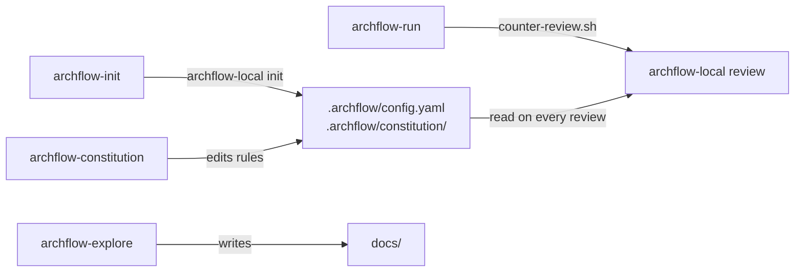
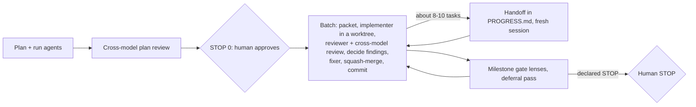

# workflow/SKILLS

**Explored:** 2026-11-11 · **Commit:** `f1fe689` · **Covers:** `skills/`, `src/init/`, `src/local/`, `assets/constitution/`, `skills/archflow-run/scripts/counter-review.sh`

ArchFlow ships four skills. Each is a short, portable instruction file (the Agent Skills format) in `skills/`, and the installer copies the same set into Claude Code, Codex and Antigravity. Skills do not carry workflow state or talk to a server: the only program behind them is `archflow-local` ([COMMANDS](../cli/COMMANDS.md)), and the only durable state is ordinary files in the repository and Git.

| Skill | Purpose |
| --- | --- |
| `archflow-init` | Scaffold the files `archflow-local review` reads and clean up registrations older versions left behind |
| `archflow-constitution` | Explain and edit the repository's constitution rules |
| `archflow-explore` | Produce or refresh the maintained `docs/` set |
| `archflow-run <name> [ask]` | Plan a large job once, then orchestrate it across fresh sessions with sub-agents, worktrees and cross-model review |

Claude Code and Antigravity invoke skills with `/` (`/archflow-init`); Codex uses `$` (`$archflow-init`). `archflow-run` is installed for every client but needs Claude Code as the orchestrator, because it generates `.claude/agents` and spawns worktree-isolated sub-agents; in another client it says so and stops.

## archflow-init

Runs `archflow-local init` from the repository root. It scaffolds `.archflow/config.yaml` (reviewer routing and approval rules), `.archflow/constitution/` (the repository's policy rules) and `.archflow/.gitignore`, removes the MCP registrations earlier versions of init wrote, and reports diagnostics: the Node version, whether the Claude and Codex CLIs are installed and logged in, and whether an ancestor Git ignore rule hides the generated files.

The skill explains the outcome in plain language. It refuses to overstate the isolation of reviewers (the diagnostics themselves say it is best-effort), never edits the project's own `.gitignore` (it asks the human to add exceptions instead), and treats a `scaffold-diverged` refusal as a question for the human: keep the repository's files, or re-run with `--force`. Invoking the skill authorizes scaffolding the shipped defaults, removing the legacy registrations init reports, and committing the resulting repository files; the skill performs that commit itself after the checks pass. When the human asks how reviewers are routed, it explains the `roles` and `producers` sections of the config and points at the commented example in the template.

## archflow-constitution

Explains and maintains the rules in `.archflow/constitution/`. The constitution is repository-owned policy for human trust boundaries and durable engineering constraints; it is not a style guide, a task checklist, or a way to compensate for a model's current weaknesses.

An explanation request edits nothing. A request to add or change a rule authorizes the scoped edit and its commit. The skill reads the existing rules first and works out the effective set after custom replacements; puts new rules and default replacements in `custom/` under an unused two-digit prefix; keeps each rule one independently reviewable policy with a stable kebab-case `id`; raises the `version` when contents change; and deprecates rather than deletes. It adds a `review_trigger` only when the repository genuinely wants a human decision whenever a condition appears, and the trigger must be something a reviewer can observe in the plan, the changed files or the repository, not a process fact such as who approved what. It names `enforced_by` only for mechanical checks that exist. It validates the whole rule set after editing and shows the diff and its practical effect on review. Refreshing shipped defaults is a separate, explicit `archflow-local init --force`; a rule edit never authorizes it.

It also says out loud, before changing them, that the rules about explicit human authority and a truthful plan, and the rule that guards the policy files, exist to keep a human in the loop. How rules are judged is on the [counter-review page](../review/COUNTER-REVIEW.md#the-constitution).

## archflow-explore

Produces or refreshes the maintained documentation set (this directory): caps-named pages, each with a stamp of date, commit and covered paths. In refresh mode it diffs each page's covered paths since its stamped commit and re-explores only the pages whose code changed, plus any focus area the user names. It may delegate large explorations to parallel sub-agents with complete briefs, reviews the pages against the code, checks links and stamps, and commits the documentation without another approval. It also makes sure the target repository's `CLAUDE.md` lists the pages and states the rule that a change altering behavior a page describes must update that page.

## archflow-run

The orchestrated workflow, for large jobs ("port this system", "build these fifty tasks") where approving each step would cost more than it is worth and one long session would run out of context. The run lives in `.archflow/runs/<name>/`: `PLAN.md` (requirements, architecture, invariants, commands, model routing, milestones, task table, declared STOPs), `PROGRESS.md` (a status line, task log, deferred findings, handoffs), `DECISIONS.md`, `BRIEF.md`, `reviews/`, and a gitignored `packets/`. Git is the record of what merged, and where the ledger and git disagree, git wins.

**Why markdown instead of a server.** A strong orchestrator follows a written protocol reliably, and resuming needs only an honest ledger and the commit history. The trust boundaries a human needs are plain rules in the skill:

- no implementation starts until the human explicitly approves the plan at STOP 0, and silence is not approval;
- every declared STOP ends the session until the human answers;
- between STOPs the run halts only for a critical finding still unresolved after the fix-round limit, a change to requirements scope or an accepted decision, a constitution `human_review_reasons` entry, or anything outward-facing or hard to reverse (pushing, deploying, installs into machine-global locations, deleting user data);
- commits stay local on the run branch, and nothing is pushed unless the human asks.

Everything else in the skill and its `PROTOCOL.md` is a default whose numbers (batch size, fix rounds, task size) can be adapted and recorded in `DECISIONS.md`.

**Why review is the part that stays tooled.** Counter-review is what hand-run workflows lacked, and routing, snapshots and structured reports are worth reusing rather than re-prompting. When an implementer returns, the orchestrator runs `archflow-local review` on its worktree through `scripts/counter-review.sh` ([COMMANDS](../cli/COMMANDS.md#how-to-treat-the-result) describes the script). At the same time it spawns a fresh reviewer sub-agent for the acceptance check; when both are done, another fresh reviewer in merge mode folds the counter-review into one findings table. A counter-review that cannot run blocks the merge and is never replaced by self-review; only the human may waive it for a named task, and the waiver is recorded.

**Why findings are decided, not sorted.** Severity says how bad a finding is, not whether to fix it now. Criticals are always fixed; a lesser finding is fixed when leaving it would cost more later (it affects tasks that build on it, it is a real bug, or no later task owns it) and otherwise deferred with a reason and an owner. After each milestone gate a deferral pass re-decides every open entry as fix, carry or close, and nothing stays open past the final STOP, whose report lists each won't-fix so the human can overturn it. Fix rounds default to three.

**Why no sub-agent waits on a review or is resumed.** A sub-agent's prompt cache lasts about five minutes; one that idles through a review, or is resumed for a fix, re-reads its whole context uncached. So the orchestrator does all the waiting, and every fix, re-review or answered question goes to a fresh agent that reads one packet and one review file. For the same reason sub-agents run only targeted tests and typechecks, never a full build, and run slow commands through `scripts/wait.sh`, which returns after about four minutes with the next command to run. Full builds and suites are the orchestrator's, once per batch.

**Why run-specific agents.** During planning the orchestrator can generate `.claude/agents/<name>-<role>.md` from the skill's scaffolds, holding the standing guidance every task of a kind needs (the reference to compare against, how to validate, invariants, review lenses). Prompts stay short, and the human approves the agents together with the plan. The run's files and generated agents are working files to delete before a pull request.

**Requirements and design.** Requirements are sized to the work rather than a separate document stage. Milestones replace per-phase design: a milestone is detailed during planning or "detailed at start", in which case its task rows are written from what the run learned and counter-reviewed (stage `plan`) without a human gate unless scope or an accepted decision changes.

## Conventions shared by the skills

- **Human gates are conversations.** Skills explain what needs attention, why it matters and the choices, in plain language, and keep digests, JSON and internal paths out unless the user asks for diagnostics.
- **A skill authorizes only what it says.** An explanation request edits nothing; an edit request authorizes the scoped change and its commit; machine-global installs are never authorized by a skill.
- **Skills state intent and trust boundaries, not workarounds.** A rule gets "never" or "must" language only when a human needs it; numbers in the skills are defaults.
- **Payloads.** Small generated JSON can be piped to a payload command on stdin; anything with authored prose or quotes goes in a file passed with `--input`, because shell quoting silently corrupts prose. A command's `{"ok": false}` result also exits nonzero, and the JSON body is the authority for the details.
- **Needs the CLI.** If `archflow-local` is missing or lacks `review`, the installed ArchFlow predates the skill; the skill tells the human to reinstall rather than installing anything itself.
